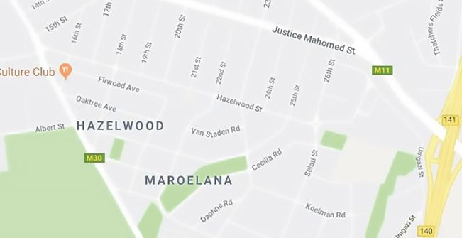

## UNIT 1.1 Data collection

In Grade 11, you created a database and manually added some data to your tables. This is a very ineffective way of adding data to a database and is only suitable for small databases. Instead of using manual entries, most databases use different techniques to capture data automatically. In this section, you will learn about a few of these techniques.

#### FORMS

A web form, is an online interactive page that allows for user input. This page imitates a physical form that users need to complete. To assist with user input and limit errors, a web form usually contains GUI components such as:

- checkboxes
- combo boxes
- spinners
- drop down lists
- text boxes
- buttons, and so on.

Web designers can also create quite sophisticated web forms for most online activities such as banking, shopping and job or enrolment applications by using programmed objects, functions and methods. These Web forms have changed the way that business is done because it limits paperwork and documentation, and favours online documentation.

#### TAGS

Electronic tags transmit a radio frequency from the tag to a tag reader, or vica versa. It transmits the information to a computer program associated with the tag. Tags can be used to track or identify different items and are often used in merchandising warehouses, for vehicle tracking, pet tracking, and so on. Let’s look at some examples of how tags are used.

RFID

RFID stands for radio frequency identification and refers to tiny chips (like those in a phone SIM card) that can store a few kilobytes of information. When scanned, this information is read and displayed on a computer. By using the correct software, it could also be added to a database directly.

**Figure 1.1:** ***An RFID access card***

RFID is used by thousands of businesses across the world. For example, RFID can be used to tag:

- **all products stored in a warehouse.** When an item is removed from the warehouse, it is automatically scanned and removed from the database.
- **tools stored in a workshop.** This allows the company to track which tools are being used, which employees are using them, and when the tools are returned.
- **the tickets of people going to conferences, sports events or concerts.** When a registered RFID chip arrives at the gate, the gates open automatically, and the data on the ticket is added to the database.
- **the tickets of people using public transport.** For example, the Gautrain uses RFID cards to allow people to board trains. The trip is recorded on a database, and the cost of the trip is subtracted from the user’s balance.
- **all products sold in a shop.** When an item is purchased, the RFID tags are scanned and the details about the product are retrieved and added to the bill. The item can then also be removed from the shop’s inventory automatically.

A basic RFID reader will only scan the information stored on RFID chips and make them available to a computer. However, there are many software solutions that will automatically take this information and add it to a database. These applications may also write additional information to the database, like the date and time that the RFID chip was scanned and the location.

E-TOLLS AND RFID

In December 2014, South African National Roads Agency Ltd (SANRAL) opened its electronic toll (or e-toll) system in Gauteng. The goal of the system was to help the government pay for the R20 billion highway improvement project that had been running since 2007.

**Figure 1.2:** ***An e-toll gantry***

Motorists had to purchase an e-tag (the RFID chip read by the toll gantry). The system used a combination of cameras and RFID readers to automatically record the information of any car driving through the gantry. This information is then stored in a database, which is used to automatically generate an invoice at the end of each month.

#### DIGITAL SENSORS

A digital sensor is an electronic or electrochemical sensor, where data conversion and data transmission are done digitally, for example, temperature, distance, humidity, light. Sensors sense a wide range of different energy forms like movement, electrical signals, radiant energy, pressure, thermal or magnetic energy. For example, wireless sensor tags connect events in physical world, for example, motion in an area, whether a door/window is opened/closed, temperature or humidity exceeding a certain limit, or smartphones or any Web browsers with internet access.

 Activity 1.2

Answer the following questions:

**1.2.1**Do some research to find out how this e-toll system automatically detects information for:

**a.**vehicles with an e-tag, and

**b.**vehicles without an e-tags.

Write a short report on how reliable you think this system is.

Discuss ways in which:

**i.**the system could work, and

**ii.**how this system could work well.

**1.2.2**Can you think of any other situations where RFID chips can be used to automatically create an invoice?

QR CODE

[https://www.youtube.com/watch?v=cZwLIxM7PdE](https://www.youtube.com/watch?v=cZwLIxM7PdE)

***[https://qrs.ly/66a7ke1](https://qrs.ly/66a7ke1)***

#### INVISIBLE ONLINE DATA COLLECTION

Databases form the heart (or memory) of the internet because they store most of the information shown on websites today.

Databases are especially important on websites where users create the content (like YouTube, Facebook and Wikipedia), as it would be impossible for a data capturer to add this information manually. Instead, these websites are set up so that any information entered by users are automatically stored in different databases. This includes items like status updates, likes, tweets and any videos or pictures the user uploaded. The databases on computers or mobile phones also store the user’s personal information, such as their email address, username and password.

**Figure 1.3:** ***Social media usernames and passwords are stored in a database***

Animation

Animation showing a banking transaction. Money is subtracted from one account, then transferred from starting bank to another bank over the internet, but before the destination account the connection is broken. This causes all the transactions to be rolled back.

**Figure 1.4:** ***Credit card payments make use of database transactions***

A cookie is a message given to a web browser by a web server. The web browser stores the message in a text file. Each time the browser requests a page from the server the message is sent back to the server. The cookie identifies users and could customise web pages for each person. When a person first enters a website using cookies, they may be asked to fill out a form providing personal information, which is packaged into a cookie and sent to the browser. The next time you go to the same website, your browser will send the cookie to the server.

Since this incredibly detailed information is recorded for billions of internet users, online advertising companies require massive databases with software that can automatically track users and their activity across web pages.

There are hundreds of different systems that have been designed specifically to automatically record information in databases, for example credit card payments, automatic toll gates, cookies and cell phone calls.

In all these examples, software was specifically built to read the information and record it in a database. This software aiso allows the companies to create automatic reports from the database. For example, you may receive a credit card statement or phone bill at the end of each month. This is a report that your service provider’s database generates automatically.

#### TRANSACTION TRACKING

Transaction data (type of transaction, store where transaction occurred, employee who performed the transaction, customer information, payment information including signatures if captured) is sent from stores to the corporate database. Data is stored on cards, such as credit cards, store cards (for example, Jet or Edgars) and store loyalty cards (for example, Clicks ClubCard, Pick ‘n Pay SmartShopper card). Some transaction tracking benefits include: consumer safety when it comes to purchasing toys, cars, food and medication, enhancing a user’s on-site experience by tracking browsing history and demographic profiles, fraud detection, and so on. The main disadvantage of transaction tracking is the unauthorised use of your personal Information.

#### LOCATION BASED DATA

**Location based data** is data that provides information about different things that can be shown on maps. **Static location-based data** includes data such as maps with roads, street names, shops, offices and other features, but also farming information, government buildings and assets, electric distribution networks with pylons and substations, military information and so on. **Non-static information** obtains the position of aeroplanes, tracking transport or stolen vehicles, personal positioning, satellites, traffic patterns, rhinos and even pets; all of which are based on input from geographic positioning systems (GPS).

**Figure 1.5:** ***A city map based on a GIS database***

Location based services (LBS) are services that use software applications together with the location-based databases to deliver a service such as finding the best route to a destination or shop, find the location or movement of a stolen vehicle, a lost pet, find the characters in the Pokemon GO game or the places where photographs were taken during a holiday trip.

Smartphones and tablets are also better at location-based computing, which refers to software based on a user’s location. Examples of location-based computing includes:

- Weather applications tell you what the weather in your specific area will be, based on your location.
- Food ordering applications can use your location to deliver food directly to you.
- Car sharing services, such as, Uber use your phone’s location to find the nearest Uber driver, who will pick you up and drop you off at the correct location.

The problem with so much data being stored in databases is how to make sense of it and use it. In the next section, you will see how companies mine databases to improve their decision making.

 Activity 1.3 Data collection

**1.3.1**Define a web form and provide an example.

**1.3.2**Provide a brief explanation of what tagging is and give an example of how a tagging system (not mentioned in this book) has been used in South Africa. (You will need to do a bit of research to answer this question.)

**1.3.3**Choose the answer and write ‘true’ or ‘false’ next to the question number. Correct the statement if it is FALSE. (You may not simply use the word ‘NOT’ to change the statement.)

**a.**RFID stands for radio frequency identifier and refers to tiny chips that can store a few kilobytes of information.

**b.**A basic RFID reader will scan all the information stored on the product with an RFID tag and make them available to a computer.

**c.**Databases are especially important on websites where users create the content, since it would be impossible for a programmer to add this information manually

**d.**Credit card payments, automatic toll gates and cell phone calls automatically record information in databases.

**e.**RFIDs automatically identify objects, collect data about them, and enter those data directly into computer systems with little or no human intervention.

**f.**Databases are not important on websites where users create the content, since it is possible for a data capturer to add this information manually.

**g.**These websites are set up so that any information entered by users are manually stored in different databases.

**h.**Invisible data capturing refers to data that is captured online, usually entered by the user.

**i.**Online data capturing refers to data that is automatically recorded and captured on a database without requiring user input and usually without informing the user.

**j.**Websites help advertisers to create advertisements that are specific to each user. To do this, advertisers create a database recording information from each user on the website that includes information like what the user searches for, what links they click on and how long they stay on different pages.

**1.3.4**Whenever an item is purchased from an online shop and the payment is received, several database transactions must occur. Underline what this includes:

- Creating a customer order in the database.
- Removing the purchased items from the company’s inventory.
- Subtracting the amount paid from the amount owed on the customer’s account.
- Placing an order with a shipping company.

**1.3.5**Explain how websites use the data they collect to determine which advertisements to run on the website.

**1.3.6**Which other examples do you know of that are commonly used to add information to a database automatically?

**1.3.7**On many websites, when an internet transaction is done, the data can be captured without the user’s knowledge or consent.

**a.**How can this type of data capturing be used in day-to-day life? Give an example of the data that is captured to support your answer.

**b.**RFID chips can also be used to automatically capture large amounts of data. What does RFID stand for?

**c.**Give four examples of how RFID cards are used in real life to capture data.

**1.3.8**What does transaction processing refer to?

**1.3.9**Why is this it important to group transfers into a single transaction?

**1.3.10**What is meant by ‘rolled back’ in the following sentence:

‘If a single task fails, the transaction is rolled-back.’

**1.3.11**Why is a complete roll-back important? Explain it in terms of a bank transfer being cancelled during the final step.

**1.3.12**Banks and online shops use transaction processing systems. Can you think of any other situations in which transaction processing systems may be used? Make a list.

**1.3.13**Answer the following questions in your own words.

**a.**What is location-based data and what is its main goal?

**b.**Name and shortly describe each of the two types of location-based data.

**c.**Which technology is generally used for location-based computing?

**d.**How would location-based computing assist the organisers in gathering information about the participants using mobile devices?

**e.**What is the name of the system used to determine the position of non-static devices?

**f.**What two technologies are combined by location-based computing to deliver a service to customers?

**g.**Give three examples of location-based services.

**h.**The Computer Olympiad will be managed from a main office and all communications will be sent from this office. On the day of the event the data will be distributed electronically to all institutions that have registered to participate in the Computer Olympiad.

Suggest ONE advantage for the Computer Olympiad if they use location-based computing.
