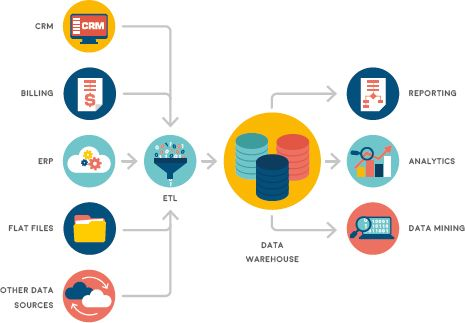

## UNIT 1.2 Data warehousing

A warehouse is a place where you can store a large number of items or products.

Did you know

Normalisation is the process of refining the structure of a database to minimise redundancy and improve integrity.

#### WHAT IS DATA WAREHOUSING?

Data warehousing is similar to how factories and distribution companies store their products in a warehouse in real life. It is a technique for storing data from more than one database. Unlike most databases, where the data is normalised and stored in the most efficient manner, data warehousing takes the data from these databases and stores it in a non-normalised way.

Since the data is not normalised, there may be **redundancies** and it can use additional storage space.

**Figure 1.6:** ***Data warehousing is used to make data available for analysis***

Did you know

Data redundancy occurs within a database when the same piece of data is held in two different places.

The goal of a data warehouse is to make the data available and ready for analysis.

It is important to understand that a data warehouse does not contain copies of the original databases, instead, it is a new database that is created to hold structured data from multiple sources. A data warehouse is usually opened to multiple people in different departments of a company. Each of these people can then access the data and use it to create graphs and reports useful to them.

Did you know

Data warehousing is a key tool in business intelligence (BI), which refers to several technologies and applications that are used to improve business decision making.

#### DATA WAREHOUSING VS DATABASE

Data warehouses and databases are similar in that they are both relational data systems. However, they were built to serve different purposes.

- A data warehouse stores a large quantity of historical data and all the data from the various databases are availabe.
- A database stores current transactions and enables easy access to specific transactions for ongoing business processes.

 Activity 1.4 Data warehousing

**1.4.1**In real life, a warehouse is a place where you can store many items or products.

**a.**What is a data warehouse?

**b.**How does data warehousing store the data? Explain it in your own words.

**c.**What are two advantages of denormalised databases?

**d.**What is the goal of a data warehouse?

**e.**Does the data warehouse replace the original data base? Give a reason for your answer:

**1.4.2**Explain in one or two sentences what this diagram means.

**1.4.3**Tabulate two differences between data warehousing and database.
