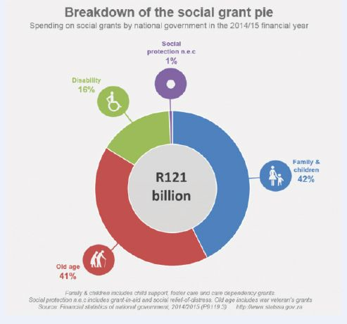
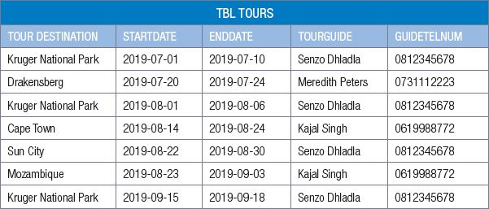

## UNIT 1.3 Data mining

#### WHAT IS DATA MINING?

**Data mining** is a process used to identify trends and patterns between different sets of data in large databases. Selecting the right data from such large amounts of data (called **big data**) can help show trends and patterns between data sets, which can improve decision making dramatically. For example:

Marketing: Data mining is used to explore increasingly large databases to improve market segmentation. By extracting data like customer age, gender, tastes etc. and looking for patterns and trends between them, it is possible to guess their behaviour in order to direct personalised loyalty campaigns. Data mining in marketing also predicts which users are likely to unsubscribe from a service, what interests them based on their searches, or what a mailing list should include to achieve a successful reponse rate.

 Activity 1.5 Data mining

You have been given access to three massive data sets containing hundreds of thousands of records. The three data sets are:

- Sales information from Amazon, including sales information per product, per product category and per country.
- Number of viewers per televisions show, including information on the time of day and the demographics of the people watching.
- List of tweets from the past year, including the content of the tweet, the hashtags used and the location the tweet was sent from.

Based on these datasets, complete the following tasks.

**1.5.1**Give three questions that would you be interested in answering using these data sets.

**1.5.2**Describe how a business owner could you use these datasets to improve their decision making on the following topics:

**a.**Women are 50% more likely to purchase your product than men. When should the business advertise their product on TV?

**b.**An electronics company is not sure if they should make an affordable electric toothbrush, or a high-quality expensive toothbrush.

**c.**A restaurant owner has noticed that people often talk about food on Twitter. How can he use this information to decide which type of restaurant to open in Johannesburg?

To make sense of the massive amounts of information available, people need to follow a basic process.This is called the data mining process.

#### DATA MINING PROCESS

To mine a database, you will:

- extract the relevant data
- look for patterns in the data
- discover knowledge from the patterns

This section will look at each of these steps in some detail.

Animation

Animation showing how small pieces from different tables are taken and combines to create a new database.

EXTRACT THE RELEVANT DATA

Once you have access to a database, you need to extract the data that will be useful to you. Many of these databases store incredible amounts of data (such as the UN database, which contains information for most countries in the world), and you may only need a small section of that data to answer your questions. Rather than filtering a massive database the whole time, you use the full database to create a new database containing only the information relevant to you.

In most situations, data will be extracted from the datasets using SQL. This is a programming language that was created specifically to manipulate and extract data from a database. By using SQL queries, users can specify exactly which data they want to extract. This is done by specifying:

- Which fields to extract
- Which data table to use
- What conditions are used

Only data that meets these requirements will then be extracted to be used for analysis.

LOOK FOR PATTERNS IN THE DATA

When working with large amounts of data, it is impossible to look at each data point on its own. Instead, you need to look for patterns in the data that will help you understand the dataset. As you will see in the later steps, these patterns can result in knowledge, which is used to make better decisions and develop strategies.

For example, you may want to determine whether fewer people use the highway between Pretoria and Johannesburg today than before the Gautrain was built. To do this, you may find Gautrain project planning data for 2014 and N1 toll gate data for 2019 and calculate daily and monthly averages that you can then compare. Based on this analysis, you will know if the Gautrain decreased the traffic on the N1 or not, and importantly, by how much. This information can then be used to decide whether or not to build a system similar to the Gautrain system for Durban or Cape Town, who have similar traffic problems.

**Figure 1.7:** ***The Gautrain is a high-speed train traveling between Pretoria and Johannesburg***
DISCOVER KNOWLEDGE

By identifying these patterns, you have turned an overwhelming amount of disorganised data into a few useful facts. This allows you to understand what happened rather than rely on vague uninformed views of people. Once you have confirmed the situation, informed decisions can be made, or strategies developed.

Example 1.1 **Data mining used for Government Social Grants**

Social grants are administered by the South African Social Security Agency (SASSA). SASSA is mandated to “ensure the provision of comprehensive social security services against vulnerability and poverty within the constitutional legislative framework”. Most social grants are “means tested”, this assesses the value of assets and income. Only a certain threshold is eligible for a social grant.

To measure the living circumstances of South African households, the Government conducts an annual General Household Survey (GHS). This is a household survey which collects big data on education, health, social development, housing, access to services and facilities, food security, and agriculture.

Using data mining techniques the relevant data that will be useful is extracted. This data is then analysed (finding patterns) and used to obtain information/ knowledge.

This knowledge can then be used to provide the necessary budget for social grants and to know what limit to set the threshold or provide reports like:

- The number of households receiving at least one form of social grant rose from 29,9% (of the population) in 2003 to 44,3% in 2010, according to the latest General Household Survey report2 from Stats SA. This rose to 45,5%in 2015.Further details and analysis on the issue of the growing social welfare net are available from Stats SA’s Poverty Trends in South Africa report3.

Example 1.2 **Data mining used by Facebook**

Facebook (and other Web giants) accumulate all our personal data over time. Increasingly, identifiable data collection is happening in more dimensions than are ever understood by most users. The more data there is in one place, the more data mining can be done. Over time, and in context of other individual data points, it becomes Big Data. Using data integration, it’s then mixed with other data sources that, as end-users, we’ll never be aware.

Companies, individuals and Facebook Itself that have access to this data extract the relevant data that Is useful to them and store it in a smaller database.

Apps, that use data analytics, are used to analyze “friends of friends” comments, textual analysis, online behaviour, and so on, to compile data about us.

This *information/knowledge* is then used to: determine our current emotional state, correlate how sad or depressed someone might be, suggest possible friends etc.

 Activity 1.6 **Data mining**

**1.6.1**The tour company requires the use of a database management system to store details of tours and tour guides. A record of the tours and the agent responsible for each tour is stored in a table called ‘TBL Tours’. The first five records of the table are shown below.

This data in the database can be used for data mining.

**a.**Give examples of three questions that can be analysed using the database?

**b.**Whom will your answers help? I.e. who will get the advantage of the answers obtained from your questions?

**c.**What must you do to mine a database?

**d.**To gain access to a database, which of the following options can you legally apply?

**i.**You can ask someone that you know to get access for the database.

**ii.**You can buy access to their database from a company.

**iii.**You can give money to an employee of the organisation to get you access to the database.

**iv.**You can hack into a database.

**v.**You could personally request access to the database.

**vi.**You could use a scraper or the website’s API to record data directly from the site.

**vii.**You can use a free database from the internet.

**1.6.2**Which website does not provide data sets for free.

**a.**Code for South Africa

**b.**Gapminder

**c.**University of Pretoria

**d.**Reddit comments

**1.6.3**What must you do after you obtained access to the database?

**a.**Filter the information

**b.**Read through the information to find what you are looking for.

**c.**Look for patterns in the information you obtained.

**d.**Extract the information, creating a new database that contains only the information relevant to you.

**1.6.4**The following is an example of a pattern that may emerge from the TBL Tour database.

**a.**Senzo does every second trip.

**b.**The starting dates are evenly spaced.

**c.**The lengths of the tours are all the same.

**d.**There is an even distribution between the different destinations.

**1.6.5**The final step in the data mining process is _____

**a.**Extracting data.

**b.**Obtaining knowledge

**c.**Developing a strategy.

**d.**Accessing a data set

**1.6.6**Which of the following targets are SMART.

**a.**By decreasing the price of Gautrain tickets by 70%, you hope to increase the number of passengers by 20% over the next six months.

**b.**By decreasing the price of Gautrain tickets, you hope to increase the number of passengers by 20%.

**c.**By decreasing the price of Gautrain tickets by 10%, you hope to increase the number of passengers by 20% over the next six months.
