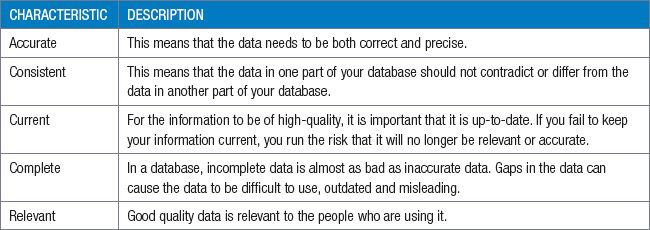
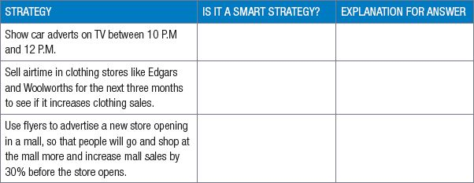

## UNIT 1.4 Caring for and managing data

In this unit, you will learn more about the value of data and how data can be protected.

#### VALUE OF DATA AND METADATA

Data can be valuable for many different reasons. For example, online shopping websites can charge owners a fee for placing an advertisement of their house, used car or gym equipment on the website. However, the only way in which owners will be willing to pay this fee is if the database already contains many other products. To gather the data needed to sell these products, the website’s creator can ask sellers to enter the important data for their products on the website, from where it is added to the database.

For a database to be useful, it needs to record and store valuable and useful data. To decide if the data is valuable to record, you can ask yourself these questions:

- Will I ever use the data in this field?
- Will anyone else use the data in this field?
- What fields do I need specifically for my application?
- What fields would I need for my application in the future?

Based on these questions, you can determine whether certain types of data are valuable to record and store in your database. Only data that will potentially be used by you (either now, or in the future) is valuable. Data that will not be used increases the size of your database without adding value to it.

Once you have determined whether the data itself is valuable, you need to ensure that the data is of a high quality. The following five characteristics determine the quality of the data.

#### HOW TO PROTECT DATA

Databases need to be protected from several different threats, including incorrect data entry, data corruption, data loss, accidental data deletion, purposeful data deletion and unauthorised access. In the following sections, you will look at eight tools and techniques that can be used to protect databases from these threats:

- Data validation
- Data verification
- Data integrity checks
- Logging changes
- Data warehousing
- Access control
- Parallel data sets

Since no single tool offers perfect protection against all threats, most large databases use most or all these tools.

DATA VALIDATION

**Data validation** refers to the process in which you check whether the data is accurate, in the correct format or of the correct type before allowing your database to record it. This ensures that the data in your database is consistent and accurate. It can also be used to prevent certain types of unauthorised access (such as **SQL injections**).

For example, if you are recording data for a government survey, you can use a digit validation to ensure all people’s ID numbers are exactly 13 digits long. This prevents you from accidentally adding incorrect ID numbers to the database.

DATA VERIFICATION

Data verification is a manual technique that can be used to make sure that the data on a database is correct and accurate. There are two main ways to do this:

- **Full verification** which requires that each piece of data that is entered into a database is read and checked by someone. This, however, can be very time consuming.
- **Sample verification**, in which a randomly selected sample of data is checked to ensure there are not systematic errors. This can help you to notice errors that occur in all data, but with this method it is possible to miss small mistakes (like typing errors).

DATA INTEGRITY

When we speak about data integrity, we are referring to the reliability, accuracy and how trustworthy data is over its entire lifecycle. This ties in with **data security** because uncorrupted data (integrity) is considered to be ‘clean data’ that stays unchanged throughout its lifecycle.

Many DBMSs have built-in **integrity controls** that help to maintain the data integrity. This includes features such as data validation and access control, but also refers to several automatic maintenance processes to prevent data corruption and errors from occurring in a database.

LOGGING CHANGES

**Logging** is the process of recording any changes made by users to a database. While logging does not directly protect a database from any possible threats, it can discourage people from sabotaging a database and make it easier to solve any problems once they occur.

This is called creating an **audit trail**. The audit trail records exactly:

- who made the changes
- what the user changed
- when they made the changes.

DATA WAREHOUSING

Data warehousing is a technique used for storing data from more than one database, it is usually stored in a way that is secure, reliable and easy to retrieve. While data warehousing is generally not considered as a security tool, it can help improve data integrity in several ways:

- Data warehouses make incorrect data entries or data corruption more visible by allowing data analysis.
- Data warehouses can make data loss more visible, allowing the problem to be fixed.
- Data warehouses can be used to recover critical data if it is deleted or corrupted.

Data warehouses are also a potential security weakness for databases. Your database could have all the best security features in the world, and it would not matter if hackers could simply access your data warehouse.

ACCESS CONTROL

Access control refers to managing and controlling the parts of a database that users have access to. By limiting the number of people who can change a database, and by limiting what changes each user can make, you can reduce the damage that any single user can do to a database. This becomes especially important when many users have access to your database.

There are three important ways to control access to your data:

- Passwords ensure that only the owner of a username can log in with that username.
- User rights determine which tables and fields every username can access, and what changes (if any) the user can make to these tables. This prevents others from gaining access to certain data or making changes they are not authorised to do.
- Good database security ensures that the data is secure and that outside people cannot find other ways to access the database.

For example, by using access control on a large news website, regular guests may be able to read stories but not change the data. Writers may be able to add new stories to the website but not add new users or delete stories. Finally, one or two administrators may be able to add new users or delete stories.

PARALLEL DATA SETS

Backups are the most important tool to protect databases from data loss and data corruption. To ensure that data has not been corrupted or deleted, the database is checked at intervals against a perfect copy of it, called a parallel data set. If there are differences, it means that data was either corrupted or deleted.

A company, like YouTube, would break the database into smaller pieces and have multiple backups of each piece. In this way you never risk losing the entire database at once, and even if a database crash occurs, the system can automatically load an existing backup while creating new backups.

Database backups should be protected as securely as the database itself. There have been many instances of websites where the database backup, rather than thecan protect data from data corruption, data loss, accidental deletion and purposeful deletion.

QR CODE

[https://www.youtube.com/watch?v=avP5d16wEp0](https://www.youtube.com/watch?v=avP5d16wEp0)

***[https://qrs.ly/4la5pff](https://qrs.ly/4la5pff)***

 Activity 1.7 **Caring for and managing data**

**1.7.1**Choose the correct answer.

**a.**Data validation refers to _____?

**A.**Built-in integrity controls that help to maintain the data integrity.

**B.**A technique used for storing data from more than one database in a way that is secure, reliable and easy to retrieve.

**C.**The process in which you check whether the data is accurate.

**D.**A manual technique that can be used to make sure that the data on a database is correct and accurate.

**b.**Verification refers to _____?

**A.**Built-in integrity controls that help to maintain the data integrity.

**B.**A technique used for storing data from more than one database in a way that is secure, reliable and easy to retrieve.

**C.**The process in which you check whether the data is accurate.

**D.**A manual technique that can be used to make sure that the data on a database is correct and accurate.

**c.**Warehousing refers to _____?

**A.**Built-in integrity controls that help to maintain the data integrity.

**B.**A technique used for storing data from more than one database in a way that is secure, reliable and easy to retrieve.

**C.**The process in which you check whether the data is accurate.

**D.**A manual technique that can be used to make sure that the data on a database is correct and accurate.

**d.**Databases need to be protected from several different threats, including:

**A.**Data mining

**B.**Unauthorised access

**C.**Data redundancy

**D.**Audit trails

**e.**What does an audit trail record? [**Hint:** This question has more than one correct answer.]

**A.**Who made the changes?

**B.**Why were the changes made?

**C.**What did the user change?

**D.**When did they make the changes?

**f.**Explain what data corruption is.

**A.**When a hacker steals money from someone else using personalised data.

**B.**When someone says something that is not true about someone else on the internet.

**C.**A criminal action by someone in a position of power using private data.

**D.**Errors in computer data that occur during writing, reading, storage, transmission, or processing, which introduce unintended changes to the original data.

**g.**Which of the following threats are prevented by the validation of data?

**A.**Incorrect data entry

**B.**Data corruption

**C.**Accidental deletion

**D.**Data loss

**1.7.2**Explain in your own words why data is valuable.

**1.7.3**List three tools and techniques that can prevent accidental and purposeful data deletion.

**1.7.4**Explain how parallel data is used to detect and correct data corruption or loss

**1.7.5**Today, the entire world’s financial system is stored on databases that are connected to the internet. Whether you are an individual with R10 in your bank account or a massive company with billions of Rand in your account, your money is stored on a database connected to the internet. As you can imagine, this data is not only incredibly valuable, but also incredibly important to protect.

Answer the following questions.

**a.**List six techniques that can be used protect data.

**b.**Criminal hackers around the world are trying to break into banks’ databases. List two techniques that can be used to protect data from unauthorised access.

**c.**What is data integrity and why is data integrity critical for a bank’s database?

**d.**Do you think bank’s make backups of their databases? Give reasons for your answer.

CONSOLIDATION ACTIVITY Chapter 1: Database Management

**1.**Choose the correct answer.

**a.**Which of the following scenarios does NOT need a database?

**A.**Storing the credentials of all Gmail accounts.

**B.**Backing up all the information on your personal computer.

**C.**Storing all the webpages of a website.

**D.**Storing all the information about a business’s inventory.

**b.**Which of the following techniques is NOT used to protect data in databases?

**A.**Data encryption

**B.**Data validation

**C.**Data verification

**D.**Access control

**c.**Integrity control is used to check ______.

**A.**Unauthorised access, Data loss and Data corruption.

**B.**Data corruption, Incorrect data entry and Data loss.

**C.**Incorrect data entry, Data corruption and Purposeful deletion.

**D.**Purposeful deletion, Accidental deletion and Unauthorised access.

**d.**Which of the following techniques can be used to recover lost data?

**A.**Access control

**B.**Data verification

**C.**Data validation

**D.**Data warehousing

**e.**Which of the following people would financially benefit from data mining?

**A.**Online advertisers

**B.**Programmers

**C.**Database administrators

**D.**Security personnel

**f.**When you create a data warehouse you need to _____ the data.

**A.**Access, Analyse and Use

**B.**Find, Extract and Store

**C.**Access, Extract and Load

**D.**Extract, Transform and Load

**g.**In location-based data, which of the following is an example of non-static information?

**A.**The most popular Gautrain routes.

**B.**The current flight route of an aeroplane.

**C.**The location of a car.

**D.**The location of a hotel.

**2.**Indicate if the following statements are ‘True’ or ‘False’. Choose the answer and write ‘true’ or ‘false’ next to the question number Correct the statement if it is FALSE. Change the underlined word(s) to make the statement TRUE. (You may not simply use the word ‘NOT’ to change the statement.)

**a.**Full verification is when someone randomly selects a sample of data and manually checks it for systematic errors.

**b.**Gapminder provides free access to databases of South African matric results.

**c.**SMART strategies are Specific. Measurable. Achievable, Relevant and Time-bound.

**3.**Choose a term/concept from COLUMN B that matches a description in COLUMN A. Write only the letter next to the question number (e.g. 1-A).

**4.**Explain TWO ways RFIDS can be used to improve each of the following industries:

**a.**Retail stores

**b.**Train transportation systems.

**c.**Universities and colleges

**d.**Medical hospitals

**5.**Below are THREE development strategies based on different databases. State which of them are SMART strategies. Give a reason for your answer.

**6.**Other than banking, name ONE other industry that can make use of database transaction tracking. Also provide an example of a scenario in which they would use it.

**7.**Cherry wants to expand her small bakery business, by creating a website so that she can sell her goods online. Cherry will need to make use of a DBMS and she will need to find ways to secure her business’s data.

**a.**Who would Cherry need to hire to help her keep her create, maintain and secure her database.

**b.**Mention ONE way location-based technology can help Cherry expand her business.

**c.**Mention ONE way Cherry can use data mining to improve and expand her business.
