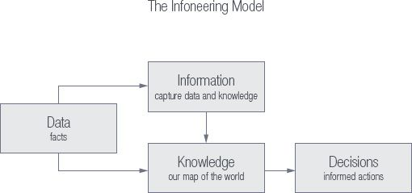
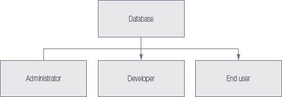
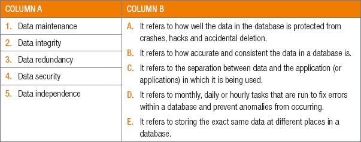

## UNIT 2.1 Characteristics of a good database

All good databases should begin with valuable metadata and data. In Chapter 1 we looked at the characteristics of valuable data and how to manage that data. These are illustrated in Figure 2.3 below:

**Figure 2.3:** ***How to manage valuable database***

Let’s now look at the characteristics of a good database:

- The database should be strong enough to store all the relevant data and requirements.
- Should be able to relate the tables in the database by means of a relation, for example, an employee works for a department so that employee is related to a particular department. We should be able to define such a relationship between any two entities in the database.
- Multiple users should be able to access the same database, without affecting the other user. For example, several teachers can work on a database to update learners’ marks at the same time. Teachers should also be allowed to update the marks for their subjects, without modifying other subject marks.
- A single database provides different views to different users, it supports multiple views to the user, depending on his role. In a school database, for example, teachers can see the breakdown of learners’ marks; however, parents are only able to see only their child’s report – thus the parents’ access would be read only. At the same time, teachers will have access to all the learners’ information and assessment details with modification rights. All this is able to happen in the same database.
- **Data integrity** refers to how accurate and consistent the data in a database is. Databases with lots ofmissing information and incorrect information is said to have low data integrity.
- **Data independence** refers to the separation between data and the application (or applications) in whichit is being used. This allows you to update the data in your application (such as fixing a spelling mistake)without having to recompile the entire application.
- **Data Redundancy** refers to having the exact same data at different places in the database. Data redundancy Increases the size of the database, creates Integrity problems, decreases efficiency and leads to anomalies. Data should be stored so that It Is not repeated In multiple tables.
- **Data security** refers to how well the data in the database is protected from crashes, hacks andaccidental deletion.
- **Data maintenance** refers to monthly, daily or hourly tasks that are run to fix errors within a databaseand prevent anomalies from occurring. Database maintenance not only fixes errors, but it also detects potential errors and prevents future errors from occurring.

There are also many people involved with organising a well-run database. These are:

- the **developers**, who design and develop the database to suite the needs of an enterprise
- the **administrator**, who:
- checks the database for its usages
- who is checking it
- provides access to other uses
- provides any other maintenance work required to keep the database up to date
- the **end user**, who uses the database, for example, teachers or parents.

**Figure 2.4:** ***People involved with organising a well-run database***

 Activity 2.1

**2.1.1**Choose a term/concept from COLUMN B that matches a description in COLUMN A. Write only the letter next to the question number (e.g. 5–F).

**2.1.2**Describe the three types of people who are involved with a database.

**2.1.3**List the five characteristics of quality data.

**2.1.4**A school would like to create a database that can:

- keep the parents informed about their child’s academics, assessments and school activities
- help the teachers record work and assessments
- store details of each child and their families.

**a.** Work in small groups of four or five learners. Discuss each characteristic of a good database and explain these referring to the scenario above.

**b.** Use a mindmap to present your discussion.
