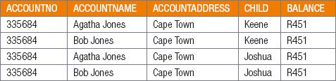
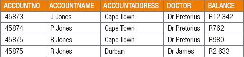

## UNIT 2.2 Problems with Databases

If a flat-file database is poorly planned, denormalised and inconsistent, it will create problems when trying to insert, delete or modify the records (tables) in the database. This causes **anomalies**, which make handling the data increasingly difficult as the database grows. It also makes the data integrity harder to maintain. Trying to make the data consistent once an anomaly occurs can become quite difficult.

There are three types of problems that can occur in databases:

- **Insertion anomaly:** The database has been created in such a way that required data cannot be added unless another piece of unavailable data is also added. For example, a hospital database that cannot store the details of a new member until that member has been seen by a doctor.
- **Deletion anomaly:** The legitimate deletion of a record of data can cause the deletion of some required data. For example, deleting some of the patient’s details can remove all the details of the patient from the hospital database.
- **Modification anomaly:** Incorrect data may have to be changed, which could involve many records having to be changed, leading to the possibility of some changes being made incorrectly.

**Example 2.1** Problems that occur in a database

For example, look at the below schema that represents information related to a school:

AccountInfo

Problems:

- **Data redundancy:** Data redundancy refers to storing the exact same data at different places in a database. Data redundancy increases the size of your database, creates integrity problems, decreases the efficiency of the database and can lead to database anomalies. Data should be stored in such a way that it should not be repeated in multiple tables. The family can be represented as one unit.
- **Update anomaly:** Data will be inconsistent if one entity is updated, for example, if the family address changes, the data capturer will need to change all four entities.
- **Unable to represent some information:** the school cannot keep information about learners who are on the waiting list as they do not have an account with the school.
- **Deletion anomaly:** closure of the account for one child will remove all data of the second child from the database.

 Activity 2.2

**2.2.1**List the three types of anomalies and provide an example for each one.

**2.2.2**Look at the below schema that represents information related to a hospital:

AccountInfo

List and explain at least four anomalies with this database.
