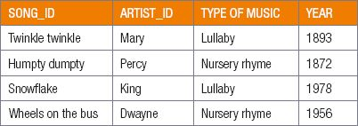
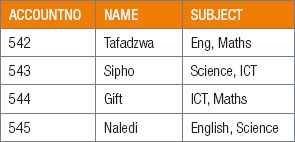
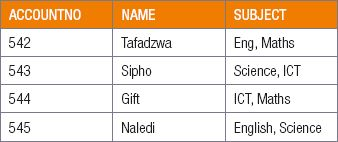

## UNIT 2.3 How to get rid of Anomalies

To prevent anomalies you need to normalise the database by efficiently organising the data in a database.According to Edgar F Codd, the inventor of relational databases, the goals of normalisation include:

- removing all redundant (or repeated) data from the database
- removing undesirable insertions, updates and deletion dependencies
- reducing the need to restructure the entire database every time new fields are added to it
- making the relationships between tables more useful and understandable.

Normalisation is a systematic approach of decomposing tables to eliminate data redundancy and Insertion, Modification and Deletion Anomalies. The database designer structures the data in a way that eliminates unnecessary duplication(s) and provides a rapid search path to all necessary information. It is a multi-step process that puts data into tabular form, removing duplicated data from the relation tables. This process of specifying and defining tables, keys, columns, and relationships in order to create an efficient database is called **normalisation**.

Normalisation will reduce the amount of space a database uses and ensure that data is efficiently stored. Without normalisation, database systems can be inaccurate, slow, and inefficient. They might not produce the data that you expect.

In practice this means changing your database so that the following requirements are met:

- each table must have a **primary key**
- each record should have single valued attributes/columns (atomic)
- there should be no repeating groups of information.

Keys are used to establish and identify relationships between tables and also to uniquely identify any record or row of data inside a table. A key can be a single attribute or a group of attributes (compositeprimary key), where the combination may act as a key. Keys help us to identify any row of data.

When designing a database, the four types of key fields are:

- **Primary key:** the field selected by the database creator to uniquely identify each record on a table. For example, each song in your music database might have a primary key field called “song_id”.
- **Alternative key:** a field containing unique values that could be used as the primary key but is not currently set as the primary key, for example, artist_id.
- **Foreign key:** a field containing values from a different table’s primary key field. Foreign keys are used to show the relationship between different tables. For example, each song in your music database might have a foreign key field called “artist_id” that links the song to a specific artist on an “artists” table.
- **Composite key:** a combination of more than one field that uniquely identifies each record on a table, for example, song_id and artist_id.

Let’s use this example to understand the four main types of keys:

Normalisation rules are divided into the following normal forms:

#### FIRST NORMAL FORM (1NF)

For a table to be in the **First Normal Form**, it should follow the following four rules:

- **Each column must have a separate field/attribute.** Each column of your table should not contain multiple values. For example, imagine the database for Facebook status updates, specifically the table related to likes. For the records to be indivisible, each like should be stored in a separate record. In this way, each record would either have occurred or not occurred. There is no way to say that only a small part of the like occurred, while a different part did not. However, if all the likes for a status update are stored in a single record, then the record would be divisible, since it would be possible for some of the likes to have occurred while others did not occur.
- **Values stored in a column should be of the same kind or type (domain).** In each column the values stored must be of the same kind or type.
- **All the columns in a table should have unique names.** Each column in a table should have a unique name to avoid confusion at the time of retrieving data or performing any other operation on the stored data. For example, specify Child’s name and parent’s name, don’t use ‘Name’.
- **The order in which data is stored, does not matter.** For example

- The table complies to three rules out of the four rules: the column names are unique, the data stored is in the correct order and there are no inter-mixed different types of data in the columns. However, the learners in the table have opted for more than one subject. This data has been stored in the subject names in a single column. As per the 1NF, each column must contain a single value.

#### SECOND NORMAL FORM (2NF)

For a table to be in the **Second Normal Form**:

- it should be in the First Normal Form.
- and it should not have Partial Dependency.

This is where an attribute in a table depends on only a part of the primary key and not on the whole key. For example, a table records the primary keys as student_id and the subject_id of each learner. Only the teacher’s name depends on subject. So, the subject_id, and has nothing to do with student_id.

#### THIRD NORMAL FORM (3NF)

A table is said to be in the **Third Normal Form** when:

- it is in the Second Normal Form.
- it does not have Transitive Dependency. Transitive Dependency occurs when an attribute/field depends on other attributes/fields rather than depending on the primary key.

This is an indirect relationship between values in the same table.

 Activity 2.3

**2.3.1**Explain why normalisation is important for a database.

**2.3.2**How can normalisation be reached?

**2.3.3**List and describe the four types of key fields that can be used in a database.

**2.3.4**How would you fix the below table to reach 1N?

**2.3.5**Give examples, not mentioned above, of the different key fields.

**2.3.6**Using the information in the table below, give examples of any two keys.

**CONSOLIDATION ACTIVITY** Chapter 2: Database design concepts

**1.**Choose the correct answer.

**a.**Which of the following scenarios does NOT need a database?

**A.**Storing the credentials of all Gmail accounts.

**B.**Backing up all the information on your personal computer.

**C.**Storing all the webpages of a website.

**D.**Storing all the information about a business’s inventory.

**b.**Which of the following is a characteristic of a good database?

**A.**Making copies of data in a database for backup.

**B.**Keeping the data and application connected and dependant on each other.

**C.**Preventing errors from occurring in the database.

**D.**Storing data in different formats.

**c.**Which of the following is needed to make each record in a database table different?

**A.**Secondary key

**B.**Foreign key

**C.**Primary key

**D.**Alternative key

**2.**List the four types of keys used to design a database. Design a table to use as an example.

**3.**In database design what are the requirements for 1NF, 2NF and 3NF?
