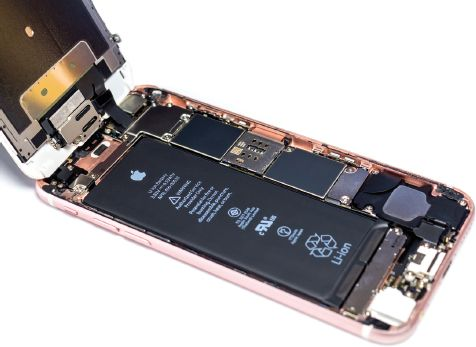
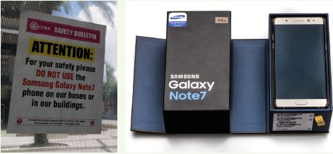

## UNIT 3.1 Mobile technologies

In ICT, mobile technologies refer to computing devices like smartphones, laptops and tablets. These are small, but powerful, devices that are easy to carry around. This unit will look briefly at the advantages of mobile computers, before looking at the constraints faced by mobile computer creators.

#### UNDERSTANDING SMARTPHONES

Small, mobile computers and smartphones have most of the same hardware as desktop computers. As such, it is important to understand how smartphone components compare with those of desktop computers. In general:

- A smartphone features an onscreen-touch keyboard that is much smaller than that of a standard computer. The keyboard and mouse of a standard computer is prefferred becausee of the comfortable sizing.
- Smartphones screens are touch screens that are smaller than desktop screens.
- Standard computers generally can be fitted with more RAM and faster processsors, making them better suited to tasks that require significant processing power.
- Smartphones come standard with communication devices like bluetooth and wifi, making them better at connecting to the internet via the numerous hotspots anywhere in the world.

This means that desktop computers are more powerful and are better suited for serious computing tasks, whether it is a processor intensive task such as encoding videos or inputting large amounts of data. However, high-end smartphones are small, easy to carry around and better suited than computers at many tasks requiring a very mobile computer. This includes tasks like reading messages and emails, setting reminders, checking the weather, updating social media accounts, making bank payments, doing Google searches and making voice and video calls.

Smartphones and tablets are also better at location-based computing, which refers to software that changes the application based on a user’s location. As you have learned in Chapter 1, examples of location-based computing include weather applications, food ordering applications, car sharing services, dating applications and **augmented reality (AR)** applications.

All these technologies use a combination of GPS and mobile internet connections to improve the service they offer you. Many of these location-based services are unique to mobile computers.

#### ADVANTAGES OF MOBILITY

When compared to desktop computers, mobile computers have several significant advantages. Amongst these advantages is:

- **size and weight:** due to these devices being small and light weight, they are easy to carry around, easy to keep on hand, can be used in any location and are comfortable to use without a desk.

As smartphones, tablets and notebooks have become more powerful, the number of uses that desktop computers are significantly better at (like gaming and video editing) have decreased, while the number of tasks that mobile computers are significantly better at continues to increase.

#### MOBILE CONSTRAINTS

Mobile computing constraints refers to the disadvantages of smart phones, laptops and tablets caused through battery life and computing power versus power consumption.Let’s work through each constraint in order to understand how these constraints affect mobile computers.

BATTERY LIFE

The processing power of a CPU is closely linked to the amount of electricity available to it. The more power your CPU uses; the more instructions it can complete. The problem for smartphones and tablets is that they have a limited amount of power stored in the battery, and this power generally needs to last the whole day.

**Figure 3.1:** ***Smartphone batteries are designed to last at least one day on a single charge***
COMPUTING POWER VS POWER CONSUMPTION

Because of the small size of mobile devices (especially smartphones and tablets), all smartphone components need to be miniaturised. The physical size of a smartphone or tablet CPU is almost the same as the physical size of a desktop CPU. However, unlike desktop CPUs, these chips contain many components, including a CPU, GPU, LTE modem, Wi-Fi connector, RAM, Bluetooth connector and GPS tracker. In a desktop, each of these components are separate – this means that each item can be more powerful.

Even the biggest smartphone monitor is tiny compared to a desktop monitor and can only display a limited amount of information. This makes it unsuitable to use applications that require a large amount of information to be shown (such as spreadsheets or word processing).

- While this works well when it is in a user’s hands, it makes it difficult to use with a physical mouse and keyboard.

**Figure 3.2:** ***Smartphone do not show large amounts of data well***

The last element we will explore is the size of the keyboard. While a smartphone or tablet keyboard is well suited to sending quick messages or occasionally typing an email, they are not well suited to entering large amounts of text

Taken together, these functions make smartphones and tablets less suitable for tasks requiring a lot of processing power or user input.

Did you know

A high-end gaming PC uses more power in one day than a high-end smartphone uses in a year!

Because of this, smartphones simply cannot run the same CPU-intensive programs as computers. Even if they could somehow get rid of all the heat this would generate, their battery would go flat in a few minutes.

 **Case Study** **Samsung Galaxy Note 7 heat problems**

In 2016, the Samsung Galaxy Note 7 was one of the fastest and most expensive smartphones of the year. However, a few weeks after the phone launched, Samsung received thousands of complaints that the phone was heating up to dangerous levels and were forced to recall and refund the owners of more than 2 000 000 Galaxy Note 7s.

**Figure 3.1:** ***Many organisations banned people from travelling with Galaxy Note 7’s***

Two months after being released, Samsung issued a full recall on all Samsung Galaxy Note 7s and stopped all production of the phone. After testing more than 200 000 phones, Samsung announced that the problem was with the lack of space between the CPU and the battery. As a result, the connectors inside the battery warped from the heat, which caused some of them to short circuit and catch fire.

 Activity 3.2 **Mobile technologies**

**3.2.1**Choose the answer and write TRUE or FALSE next to the question number. Correct the statement if it is FALSE. Change the underlined word(s) to make the statement TRUE. (You may not simply use the word ‘NOT’ to change the statement.)

**a.**In ICT, mobile technologies refer to computing devices that are small, but powerful, devices that are easy to carry around.

**b.**The current trend shows that more desktops are sold than mobile devices.

**c.**Notebooks are not suited to do tasks such as sending long emails or creating documents.

**d.**Mobile computing constraints do not refer to the disadvantages of mobile computers.

**e.**The more power a CPU uses the less heat it generates.

**3.2.2**Compare mobile devices with desktop computers and give at least THREE reasons why mobile devices are becoming more popular than their larger counterparts?

**3.2.3**What are the limitations of smartphone monitors as compared to desktop monitors?

**3.2.4**You bought yourself a good middle-of-the-range smartphone so that you can play your games wherever you are. However, you soon realise that most of the time you are playing a game, your phone becomes very hot.

**a.**Why does this happen? Explain.

**b.**Why does this not happen when you play the same games on your desktop computer? Explain in your own words.

**c.**What other problems may you experience when playing games on your smartphone and why does it happen?

**d.**Choose whether you would prefer using a desktop computer or a laptop/mobile device. List all the pros and cons of the device you choose. Your list should convince someone else to switch from their current device.
