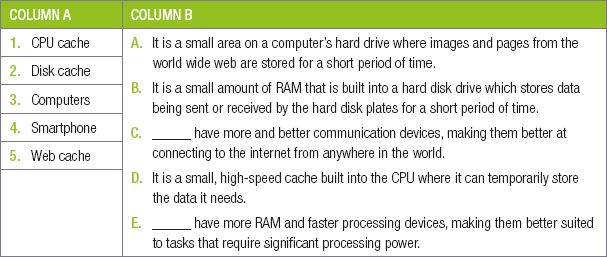

## UNIT 3.2 Factors influencing performance of a computer

Having looked at some of the differences between mobile technologies and traditional desktop computers, it is useful to see exactly how the different computer components influence the performance of a computer or smartphone.

There are two factors that have a direct effect on your CPU’s (and therefore, your computer’s) performance: **The speed of the CPU** and the **ability of the CPU to run multiple processes**.

The speed of the CPU is a direct measurement of how many instructions it can complete per second. The more instructions it can complete, the faster the CPU and your applications run. This is closely linked to the CPU’s clock speed (given in MHz or GHz), which indicates how frequently it will complete an instruction per second.

The second factor is the ability of the CPU to do multiprocessing. Multiprocessing allows a computer to complete tasks from multiple applications at the same time. A CPU that is good at multiprocessing might be able to complete the instructions from hundreds of processes at the same time. A CPU that is not as good at multiprocessing might start stuttering if it tries to run too many processes at once.

A slow GPU will not affect your computer’s performance on normal applications (like creating a document or browsing the web), but it will have a big effect on the performance of graphic-intensive tasks, such as playing games or creating videos.

The two main factors that affect the GPU’s performance are:

- GPU clock speed (MHz) – the higher the clock speed, the more instructions the GPU can process
- the type of GPU.

#### MEMORY CAPACITY

RAM

When the RAM capacity is too small, using the computer will become much slower as information needs to constantly be added to and removed from RAM. This will be especially noticeable when switching between two open applications since the computer would need to remove all the previously open application’s data from memory and replace it with the new application’s data. When this problem becomes serious enough, your computer might automatically close some applications to free up memory.

**Figure 3.4:** ***A computer might close applications or web pages if it runs out of RAM***
CPU CACHE

Another form of memory is caching. Caching refers to a small, temporary form of storage that is created so that the data stored in the cache can be accessed more quickly. There are three important forms of caching:

- **CPU cache:** Due to the growing difference in speed between a computer’s CPU and RAM, many CPUs now have a small, high-speed cache built into the CPU where it can temporarily store the data it needs. The speed and size of the CPU cache can have a significant impact on a CPU’s performance.
- **Disk cache:** The disk cache is a small amount of RAM that is built into a hard disk drive. It stores data being sent or received by the hard disk plates for a short period of time.
- **Web cache:** The web cache is a small area on a computer’s hard drive where images and pages from the **world wide web** are stored for a short period of time. This allows users to quickly load those images from their computers, rather than over a slow internet connection, when they open a page that they have previously viewed.

#### STORAGE

Secondary Storage (also called external memory or auxilliary storage) is not directly acessible to the CPU. The computer uses Its Input/output channels to access secondary storage and transfer the desired data to primary storage. **Hard Disk Drives (HDDs)** and **Solid State Drives (SSDs)** are used as secondary storage. Other examples of secondary storage technologies include USB flash drives, Compact Disks(CDs), Digital Video disks(DVDs) external hard disk drives.

#### SPEED

The access time per byte for HDDs or SSDs is typically measured in milliseconds (one thousandth seconds), while the access time per byte for primary storage is measured in nanoseconds (one billionth seconds). Thus, secondary storage is significantly slower than primary storage. Rotating optical storage devices, such as CD and DVD drives, have even longer access times. Once the disk read/write head on HDDs reaches the proper placement and the data, subsequent data on the track are very fast to access. To reduce the seek time and rotational latency, data are transferred to and from disks in large contiguous blocks.

New words

**seek time** – the time taken for a disk drive to locate the area on the disk where the data to be read is stored.

**rotational latency** – also called rotational delay, is the amount of time it takes for the desired sector of a disk (i.e., the sector from which data is to be read or written) to rotate under the read-write heads of the disk drive)

#### DISK CACHING

The disk cache is a small amount of RAM that is built into a hard disk drive. It stores data being sent or received by the hard disk plates for a short period of time and if the same data is required then it is taken from the disk cache improving the time it takes to read from or write to a hard disk. It is usually included as part of the hard disk or a specified portion of random access memory (RAM).

#### NETWORK INTERFACE CARD (NIC)

The NIC provides the hardware interface between a computer and a network and enables a device to network with other devices. It can either be in the form of an add-in card that fits in an expansion slot on a computer’s motherboard to expand the functionality of the system or is usually built-in and is a part of the circuit board. The standard wired NIC is measured by its speed in Mbps (Megabits per second): 10 Mbps is too slow, 100 Mbps is faster, and 1000 Mbps (1 gigabit) is the fastest.

The speed of the NIC can affect perfermance when it comes to:

- loading webpages or web applications
- downloading applications or games from the internet
- downloading program updates from the internet
- copying large amounts of data over the network
- watching multimedia over the network.

 **Activity 3.3**

**3.3.1**Choose the correct answer.

**a.**What is the purpose of the CPU?

**A.**Completes the graphics processing tasks of the computer.

**B.**Completes the general processing tasks of the computer

**C.**Slow, long-term storage of data used on the computer

**D.**Fast, long-term storage of data used on the computer

**b.**What is the purpose of the GPU?

**A.**Completes the general processing tasks of the computer

**B.**Slow, long-term storage of data used on the computer

**C.**Connects all the components of the computer.

**D.**Completes the graphics processing tasks of the computer

**c.**What is the purpose of the ROM?

**A.**It stores the BIOS, the motherboard’s operating software

**B.**Connects computers to a network and the internet.

**C.**Fast, long-term storage of data used on the computer.

**D.**Very high-speed storage which temporarily stores data the CPU is using.

**d.**What is the purpose of the HDD?

**A.**Very high-speed storage which temporarily stores data the CPU is using

**B.**Very high-speed storage which temporarily stores data the CPU is using

**C.**It stores the BIOS, the motherboard’s operating software

**D.**Slow, long-term storage of data used on the computer.

**e.**What is the purpose of a NIC?

**A.**Displays the images generated by the computer.

**B.**Connects all the components of the computer.

**C.**Connects computers to a network and the internet.

**D.**Completes the general processing tasks of the computer

**3.3.2**Choose a term/concept from COLUMN B that matches a description in COLUMN A. Write only the letter next to the question number (e.g. 1–A).

**3.3.3**Choose the correct answer.

**a.**What causes a computer program to stutter, stall, or take a long time to complete a task?

**A.**The speed of the storage device.

**B.**Slow CPU.

**C.**A RAM capacity that is too small.

**D.**All three

**b.**What is the speed of the CPU a direct measurement of?

**A.**The CPU’s clock speed.

**B.**Network speed

**C.**How many instructions it can complete per second.

**D.**The computer’s cache and RAM.

**c.**When does low NIC speed affect a computer’s performance?

**A.**When switching between two open applications.

**B.**When storing large amounts of data on a storage device.

**C.**When loading your operating system.

**D.**When watching multimedia over the network.

**3.3.4**Choose the answer and write ‘true’ or ‘false’ next to the question number. Correct the statement if it is FALSE. Change the underlined word(s) to make the statement TRUE. (You may not simply use the word ‘NOT’ to change the statement.)

**a.**When programs stutter, stall or take a long time to complete a task, the CPU is too slow.

**b.**The speed of the CPU and its ability to run multiple processes have a direct effect on the CPU’s performance.

**c.**The speed of the CPU is a direct measurement of how many instructions it can complete per minute.

**d.**The CPU’s clock speed indicates how frequently it will complete an instruction per second.

**e.**The CPUs ability to do a single task determines how good it is.

**f.**Data that the computer is using, is permanently stored by the cache and RAM.

**g.**Since the cache and RAM are both much faster than the computer’s hard drive, this ensures that the CPU has access to the data it needs.

**h.**If a computer’s RAM capacity is too small, using the computer will become much slower as information needs to constantly be added to and removed from the CPU.

**i.**Your computer (or CPU’s) cache is a slower form of memory, used to send and store all the information the CPU needs.

**j.**Storage speed is unimportant when opening a program or a large data file.

**k.**Storage speed is important when loading your operating system.

**l.**Network speed also affects the computer’s performance. It the time to download a video is shorter than the video time, the video will stutter if you try to play it on YouTube.

**m.**The network speed will negatively affect a computer’s performance when downloading applications or games from the internet.

**n.**Buses are the electrical circuit as well as the whole communication system between two devices, including the hardware components, the electrical requirements, the communication format and the software.

**o.**A faster GPU will allow you to browse the web much more quickly.

**3.3.5**Answer the following questions in your own words:

**a.**Which Three computer components can have a significant impact on a computer’s performance?

**b.**How does a CPU’s clock speed affect the computer’s performance?

**c.**Why does the speed of a storage device determine how quickly a new program opens?

**d.**Why does the computer become slower if the RAM’s capacity is too small?

**3.3.6**After owning the same computer for many years, you decide to upgrade your computer by purchasing a new CPU. Fortunately, the CPU still uses the same socket as your motherboard, so you can install the CPU without replacing the motherboard. However, after using your new CPU for a few days, you are disappointed that it has not improved your computer’s speed as much as you hoped it would, especially in games.With this scenario in mind, answer the following questions.

**a.**Although your computer has a brand-new CPU, you only have 2GB of RAM that is more than 10 years old. How can RAM affect the performance of your computer?

**b.**Thinking back, your HDD might be even older than your RAM and runs at only 5 400 RPM. How will this affect your computer’s performance?

**c.**Give three situations in which the speed of a hard disk drive is important.

**d.**Poor performance in games is often associated with a slow graphics card (or GPU). Why is this?

**3.3.7**Sandy has been experiencing the following problems whenever she is on the network. The webpages and web applications take a long time to open. She cannot download certain applications or games from the Internet. Whenever her computer starts downloading updates from the Internet, she knows it is going to take forever.

**a.**What causes this to happen?

**b.**List at least THREE other problems that she is most probably experiencing.

**c.**What can she do to fix her problems?
