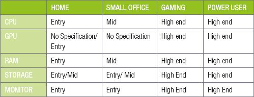
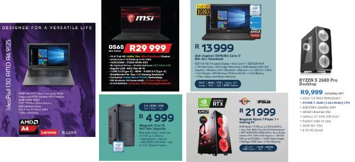
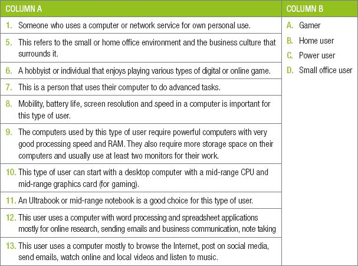
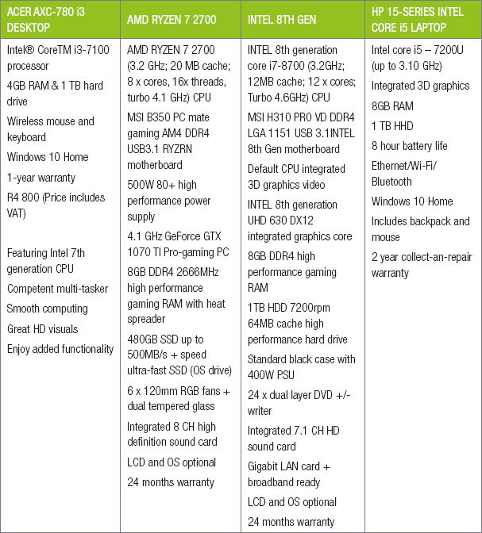
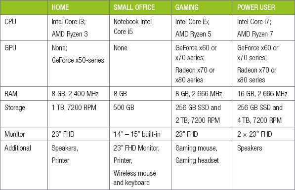
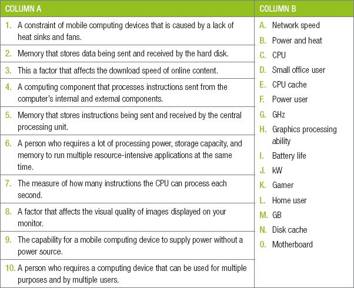
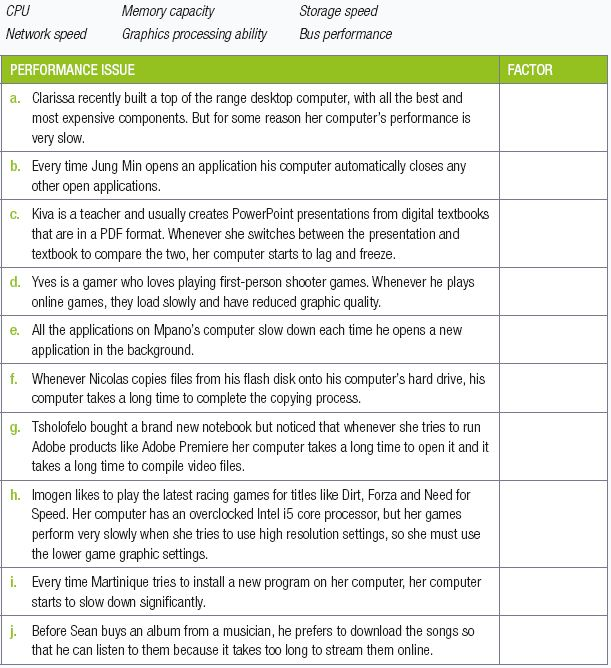
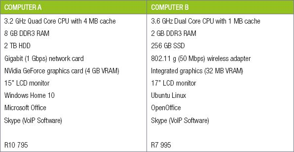

## UNIT 3.3 Motivate a typical computer system in respect of user requirements

By using top-of-the-line hardwrae components, you could build a computer able to play the latest games with ultra-quality graphics and 4K resolution, encode videos in a fraction of the time of normal computers, and complete any daily computing task while only using a small percentage of the power available!

In this unit, you will learn more about different hardware configurations. You will learn what range of hardware to select for a specific type of user, how to compare and select between two different types of hardware, and finally, how to identify the hardware configuration already installed in a computer.

#### SELECTING AN APPROPRIATE CONFIGURATION

This section will look at typical computer setups for the following types of users:

- Home user
- Small office user
- Gamer
- Power user

For each user, you will learn to identify what they are most likely to use the computer for, what components are important for their use and why certain components should be selected.

HOME USER

The average home user mostly uses a computer for:

- browsing the internet
- posting on social networks
- sending email
- doing word processing
- watching online and local videos
- listening to music.

However, categorising someone as an ‘average’ home user has become a lot harder than it used to be.

SMALL OFFICE USER

The average business user uses a computer for:

- online research
- sending emails and business communication
- using word processing and spreadsheet applications
- note taking.

None of these tasks require a very powerful computer. However, there are four factors that are particularly important to business users:

- **Mobility**, which allows them to take their computers to meetings or home.
- **Battery life**, which allows them to use their computers for extended periods of time without access to a power source.
- **Screen resolution**, which allows them to view more information on a screen at a time.
- **Speed**, since business users are usually paid for the work they deliver, the computer should never decrease their productivity.

GAMER

Modern games are designed to take advantage of the incredible processing power of CPUs and GPUs. As a result, they are one of the most processing-intensive tasks completed on personal computers.

Gaming is such a good measure of a computer’s processing power, that games are often used to **benchmark** computer hardware and see how well certain types of hardware perform.

This does not, however, mean that all gaming computers must be expensive. There are three options for gaming PCs:

- entry level
- mid-range
- high-end

The biggest difference between an entry-level gaming computer and a mid-range gaming computer is the graphics card.High-end gaming computers will be able to play all games at high or very high quality, while the most expensive of these computers will be able to play games at ultra-high quality at very high resolutions.

With gaming computers, it is incredibly important that you build a balanced setup where all the components are roughly the same speed. Having a CPU that is much faster than your GPU will not help your computer, since the quality of you game will be limited by the speed of your GPU. The same is true if you have too little or too slow RAM.

POWER USERS

The term *power user* is a general term that refers to people who use their computers to do advanced tasks. Examples of power users include computer programmers, web developers, video editors and graphic designers.

In general, these tasks do not require computers more powerful than those of gaming computers, although processing speed and RAM are especially important for power users, as it allow these users to run more applications at the same time and complete processing-intensive tasks (such as video encoding or compiling a program) more quickly. Power users may also require more storage space on their computers and usually use at least two monitors for their work.

#### SELECTING THE HARDWARE

Now that you have a basic idea of the types of computers to purchase for different users, you can look at specific components to use for different configurations. The table below suggests hardware configuration for different types of computers.

Take note

Hardware manufacturers release new components every year, and the relative strength and weaknesses of these components change every year. As such, the table above can, at best, be a starting point. Before purchasing any components, you should do research on them using the internet.

**Table 3.1:** ***Hardware configuration for different types of computers***

 Activity 3.4 **Analysing pre-built computers**

Look at the following computer advertisements, then answer the questions below.

Based on these advertisements, answer the following questions.

**3.4.1**Which computer would you recommend for a high-end gamer?

**3.4.2**Which notebook would you recommend for a power user?

**3.4.3**Which computer would you select for a family and why would you select it? Are there any extra accessories you would purchase for this computer?

 Activity 3.5 **Hardware configurations**

**3.5.1**Choose a term/concept from COLUMN B that matches a description in COLUMN A. Write only the letter next to the question number (e.g. 1–A).

**3.5.2**If you have a computer at home, what do you do on the computer as a home user?

**3.5.3**Let’s say you choose to do home-schooling where you learn and study at home, will your uses of the computer change? How?

**3.5.4**What are the four factors that are particularly important to business users when they are selecting a computer to do their work on?

**3.5.5**What are the main characteristics of a gaming PC?

**3.5.6**What is a power user? Give two examples of power users.

**3.5.7**Explain the term, “hardware configuration” in your own words.

**3.5.8**Give two reasons why you should know your computer hardware configuration.

**3.5.9**Look at the following advertisements of four computers.

Based on these advertisements, answer the following questions:

**a.**Identify the CPU used for each of the four computers.

**b.**Write down the name of one of the motherboards included in these computers.

**c.**Which computer is sold with a solid-state drive?

**d.**Why do you think each of these advertisements start by listing the computer’s CPU?

**e.**The third advertisement states that an OS is optional. What do you think this means?

**f.**Which computer would you suggest for the following users? Give reasons for your answers.

**i.**A family that will use the computer for browsing the internet and playing some games.

**ii.**A gamer and power-user.

**iii.**An office worker who often travels.

**3.5.10**This is an optional activity.

Read through the following table showing hardware configurations for different types of computers.

Based on internet research, answer the following questions:

**a.**What is the best price you can find for the home computer’s components?

**b.**How much would the gaming computer cost?

**c.**Which components have the largest impact on the price?

**d.**How much would a similar small office notebook cost?

**e.**How much does a gaming notebook cost?

**3.5.11**Building your own computer: Imagine you had a job that paid R100 per hour and wanted to save for a new computer. Based on the money you can save and the prices of components, complete the activity below:

**a.**Make a list of all the components you would purchase for your computer. Make sure to include at least the following components: CPU, motherboard, RAM, case, power supply, monitor, keyboard and mouse.

**b.**Give reasons why you selected each of your components.

**c.**Using the internet, search for a benchmark for the CPU you selected. How does it compare to other CPUs on the list?

**d.**Did you include a GPU in your computer? Why or why not?

**e.**How much would your computer cost to build?

**f.**How many hours would you need to work to save up for this computer?

**g.**Realistically, how many hours could you work per week?

**h.**Based on this information, would you change any of your components?

CONSOLIDATION ACTIVITY Chapter 3: Hardware

**1.**Choose the correct answer.

**a.**Which of the following affects the performance of the CPU?

**A.**Memory clock speed

**B.**Number of cores

**C.**Amount of RAM

**D.**Amount of space

**b.**Which of the following would permanently store the operating system?

**A.**CPU

**B.**ROM

**C.**RAM

**D.**Hard disk

**c.**Which of the following devices is best suited for location-based technology?

**A.**Smartphone

**B.**Laptop

**C.**Server

**D.**Desktop PC

**d.**Which of the following devices is best suited for creating PowerPoint presentations?

**A.**Server

**B.**Smartphone

**C.**Notebook

**D.**Mainframe computer

**e.**Which of the following devices is the best device for a web developer?

**A.**Entry-level notebook

**B.**Mid-range tablet

**C.**High-end Smartphone

**D.**Mid-range desktop PC

**f.**Which of the following does not affect a computer’s performance?

**A.**Storage capacity

**B.**Control processing unit

**C.**Central processing unit

**D.**Memory speed

**g.**If you want to install a large program on your computer, which of the following would affect your RAM’s performance?

**A.**Storage space

**B.**Storage speed

**C.**Cache

**D.**Network speed

**h.**Which of the following connects the CPU with the memory and the input and output devices?

**A.**Bus system

**B.**GPU

**C.**Network

**D.**RAM

**i.**Which of the following devices would be best suited for a small office user?

**A.**Smartphone

**B.**Desktop PC

**C.**Laptop computer

**D.**Workstation computer

**j.**Two of the most important requirements for a gamer are _______.

**A.**Mobility and storage capacity.

**B.**CPU speed and GPU processing power.

**C.**CPU speed and RAM capacity.

**D.**Cache speed and CPU speed.

**2.**Indicate if the owing statements are ‘True’ or ‘False’. Choose the answer and write ‘true’ or ‘false’ next to the question number Correct the statement if it is FALSE. Change the underlined word(s) to make the statement TRUE. (You may not simply use the word ‘NOT’ to change the statement.)

**a.**Disk cache is located on the RAM.

**b.**The purpose of a heat sink is to cool down all the internal components of a computer.

**c.**The GPU’s quality is dependent on the CPU’s speed.

**d.**Two of the most important requirements for a home user are mobility and battery life.

**e.**The most important requirements for an office user are a lot of RAM, CPU speed and storage space.

**3.**Choose a term/concept from COLUMN B that matches a description in COLUMN A. Write only the letter next to the question number (e.g. 1–A).

**4.**Determine which of the following factors should be considered for the following performance issues:

**5.**Consider the following 3 users:

**a.**Ahmed is a freelance graphic designer that travels a lot for business.

**b.**Belinda is a banker that must regularly check and edit accounting spreadsheets.

**c.**Nkosi is a professional gamer that plays at international gaming tournaments.

**5.1.**Which type of computer would be best suited for each user? Give ONE reason for each answer.

**5.2.**What type of user do you think Ahmed is? Give a reason for your answer.

**5.3.**Based on Belinda’s computing requirements, would she benefit from using a smartphone or a mobile computer. Give TWO reasons for your answer.

**5.4.  a.**Name ONE piece of computing hardware Nkosi should financially invest in upgrading. MentionTWO benefits of upgrading this piece of hardware.

**b.**Other than being potentially expensive, mention ONE other disadvantage or problem that could occur because of Nkosi upgrading this piece of hardware.

**6.**Tokozile is a young entrepreneur who wants to open a computer centre for tourists in Cape Town. Her goal is to have 16 computers with high-speed internet that can be used by tourists to browse the internet or send messages home. However, she would also like the computers to be able to play modern multiplayer games so that youths from the area will visit her centre.

She has obtained the following two quotations for her centre.

She starts her comparison by looking at the CPUs of the two computers.

**a.**Name TWO manufacturers of CPUs.

**b.**One CPU is a “dual core” CPU, while the other is a “quad core” CPU. What do these terms mean?

**c.**Which CPU will be faster for multitasking? Give reasons for your answer

**d.**The two CPUs have different amounts of cache memory. Define the term cache memory?

**e.**Tokozile expects that some of her customers will want to play games on the computers. Advise her on which computer (according to the quotations) would be best for games and why.

**f.**The computers not only have different hardware, but also different software. List the operating systems installed on each computer.

**g.**Which computer’s software will be the most expensive. Give reasons for your answer.

**h.**The operating systems of both computers support multitasking and multithreading. Define these concepts and explain how they differ.
