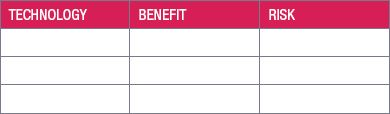
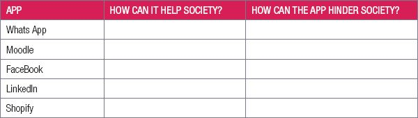

## UNIT 4.2 loT – Technologies enabling the loT and their impact on society

The Internet of Things (loT) consists of all the web-enabled devices that collect, send and act on data they acquire from their surrounding environments using embedded sensors, processors and communication hardware. IoT refers to the billions of devices around the world that are connected to the internet through sensors or Wi-Fi.

#### TECHNOLOGIES THAT ENABLE IOT

The recent convergence of three technological trends has made the IoT possible:

- **Increasing processing power of embedded platforms:** due to the smaller sizes, reduce in cost and reduce in power consumption, general purpose CPU’s have gradually replaced microcontrollers in devices. The transition to CPUs is critical because CPUs can run operating systems that support networking and popular programming languages.
- **Development of smaller OSs and protocol:** as the performance of embedded platforms rose, lightweight versions of mainstream operating systems like Windows and Linux displaced embedded operating systems and brought their massive software ecosystems, and large pool of developers, with them.
- **Development of wireless communications:** Wi-Fi has gotten faster with each new addition to the 802.11 class of protocols. The connectivity options for low-power devices have also been expanding in the industrial and consumer electronics markets.Impact on society

There are many ways that IoT will affect and benefit society, below are a few examples:

- **Waste management:** sensors in a fridge will record anything that is not used so that you can examine the trends and patterns. The less waste the less pollution. Sensors in bins can record the trends and patterns of what can be recycled.
- **Daily commute:** Sensors will let you know the shortest route to your work or home; which routes would be the most economical on petrol and if you can rather take public transport. Taxi services for business meetings can be planned according to your calendar and synced with your smartphone.
- **Smart cities:** These can include fast and convenient transportation systems, street lighting that switches on or off depending on the amount of natural light and energy-efficient buildings. For example, Barcelona has a citywide WiFi and information network linked to sensors, software and a data analytics platform. This provides the city with smart water technology, automated street lighting, remote-controlled irrigation for parks and fountains, “on-demand” waste pickups, digital bus routes and smart parking meters. This has reduced traffic jams and pollution, as well as water, light and energy usage.
- **Agriculture:** Sensors can track microclimates across farms, to monitor temperature changes and humidity levels as perishable goods move from field to warehouse to store. This can extend their shelf life and eliminate waste.
- **Businesses:** IoT is used to detect and troubleshoot remote issues, predict maintenance needs, track production line efficiency, monitor devices etc. These directly impact a company’s revenue.
- **Smart water sensors:** These sensors monitor the water quality, temperature, pressure, and usage. This data is used by the water company to analyse how customers are using water and to help them be more efficient. Water leak detectors are used to find tiny leaks that can lead to huge water waste.

 Activity 4.2

**4.2.1**In small groups discuss at least three ways loT impacts society, you can research your answers. Each group presents their findings to the class.

**4.2.2**Read the following article on the top five predictions of loT in 2019.

**5 Internet Of Things Trends Everyone Should Know About**

By **BERNARD MARR**Johannesburg, 15 Feb 2018

2019 will see the Internet of Things (loT) becoming more deeply embedded in our day-to-day lives at home and at work. We may begin to hear the term itself used less frequently – but that’s because it’s moving out of the hype phase and quickly becoming a part of everyday life.

Soon, it will be taken for granted that pretty much any device we own – cars, TVs, watches, kitchen appliances can go online and communicate with each other. In industry too, tools and machinery are increasingly intelligent and connected, generating data that drives efficiency and enables new paradigms such as predictive maintenance to become a reality, rather than a pipe-dream. In fact, it is predicted that by the end of 2019 there will be 26 billion connected devices around the world.

Here are five predictions about how this is likely to play out over the next 12 months as we become increasingly used to the fact that the internet isn’t just something we connect to using computers and smartphones, but virtually anything we can think of:

**Businesses will get serious about loT:** According to research by Forrester, businesses will lead the surge in IoT adoption in 2019, with 85% of companies implementing or planning IoT deployments this year.

**IoT clearly offers huge benefits to businesses:** Some examples we have seen in recent years include mannequins that can communicate with customers’ smartphones in retail environments, beaming information about products on display.

Manufacturing, however, is the clear leader when it comes to IoT deployment. Here, throughout 2019, businesses will increasingly see the value in connected machinery that is capable of reporting every detail of its operating parameters and efficiency to other smart, connected devices.

Predictive maintenance is something that has been promised for a while by tech evangelists but is currently only achieved by the biggest players who have invested heavily in IoT for several years now.

With a growing **understanding of when these solutions are (or aren’t) useful, these solutions will start to trickle down** to smaller organizations, that can be confident that their investments will pay off.

*[Source: [https://www.forbes.com/sites/bernardmarr/2019/02/04/5-internet-of-things-trends-everyone-should-know-about/#5a1e747f4b1f](https://www.forbes.com/sites/bernardmarr/2019/02/04/5-internet-of-things-trends-everyone-should-know-about/#5a1e747f4b1f), accessed 10 June 2019]*

**a.**Do you agree with each prediction?

**b.**Explain why you say so.

**4.2.3**What are your top five predictions for IoT for 2020? For each prediction provide an explanation of its use for society or businesses.

**4.2.4**Watch the following video on The Ultimate Smart Device: An Intelligent Diaper (or Nappy) [https://www.voutube.com/watch?v=sUvnHP7D8Uc](https://www.voutube.com/watch?v=sUvnHP7D8Uc).

**a.**Discuss the benefits of this IoT device.

**b.**Do you think it is necessary? Explain.

CONSOLIDATION ACTIVITY Chapter 4: Social implications

**1.**Mention any THREE mobile technologies that make life easier, how they have improved your life, and the danger of using this technology.

**2.**Mention any THREE mobile technologies that make life easier, how they can improve a business, and the danger of using this technology.

**3.**Research the following companies and complete the table. Sometimes an app might not have any disadvantages.

**4.**What is your ultimate smart device, either real or invented. Explain its benefits. Design an advertisement and present your smart device to the class.
