# Open Textbooks

South Africa (CAPS) Textbooks

Browse our textbooks available in

          .
          Looking for a different curriculum?
          [Change your settings](/select-region).

Download our open textbooks in different formats to use them in the way that suits you.
          Click on each book cover to see the available files to download.
          Better than just free, these books are also openly-licensed (except Information Technology and Computer Applications Technology)!
          Refer to the different open licences for each download and the explanations of the licences at the bottom of the page.

## Mathematics

- 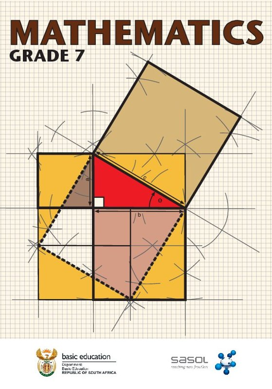
  - [Read online](/read/za/mathematics/grade-7)
  - Textbooks
    - Afrikaans
      - - [7A PDF (CC-BY-ND)](/downloads/books/maths/Gr7A_Mathematics_Learner_Afr.pdf)
        - [7B PDF (CC-BY-ND)](/downloads/books/maths/Gr7B_Mathematics_Learner_Afr.pdf)
    - English
      - - [7A PDF (CC-BY-ND)](/downloads/books/maths/Gr7A_Mathematics_Learner_Eng.pdf)
        - [7B PDF (CC-BY-ND)](/downloads/books/maths/Gr7B_Mathematics_Learner_Eng.pdf)
- 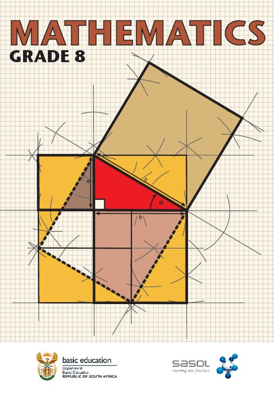
  - [Read online](/read/za/mathematics/grade-8)
  - Textbooks
    - Afrikaans
      - - [8A PDF (CC-BY-ND)](/downloads/books/maths/Gr8A_Mathematics_Learner_Afr.pdf)
        - [8B PDF (CC-BY-ND)](/downloads/books/maths/Gr8B_Mathematics_Learner_Afr.pdf)
    - English
      - - [8A PDF (CC-BY-ND)](/downloads/books/maths/Gr8A_Mathematics_Learner_Eng.pdf)
        - [8B PDF (CC-BY-ND)](/downloads/books/maths/Gr8B_Mathematics_Learner_Eng.pdf)
- 
  - [Read online](/read/za/mathematics/grade-9)
  - Textbooks
    - Afrikaans
      - - [9A PDF (CC-BY-ND)](/downloads/books/maths/Gr9A_Mathematics_Learner_Afr.pdf)
        - [9B PDF (CC-BY-ND)](/downloads/books/maths/Gr9B_Mathematics_Learner_Afr.pdf)
    - English
      - - [9A PDF (CC-BY-ND)](/downloads/books/maths/Gr9A_Mathematics_Learner_Eng.pdf)
        - [9B PDF (CC-BY-ND)](/downloads/books/maths/Gr9B_Mathematics_Learner_Eng.pdf)
- 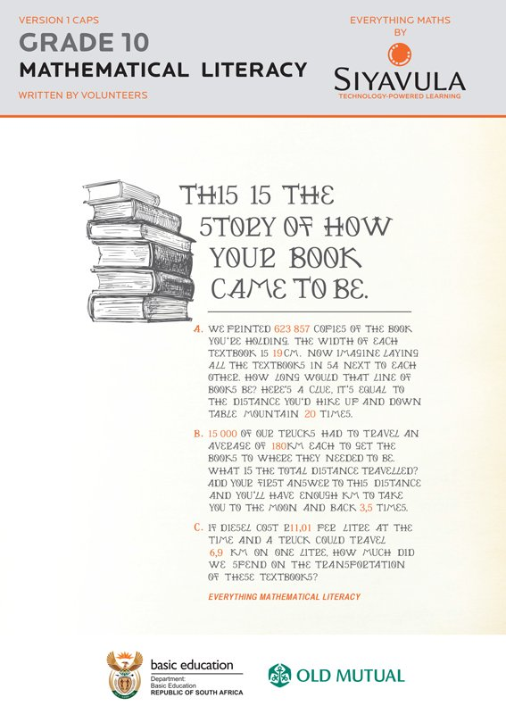
  - [Read online](/read/za/mathematical-literacy/grade-10)
  - Textbooks
    - Afrikaans
      - - [PDF (CC-BY-ND)](/downloads/books/maths-lit/Gr10_MathsLit_Learner_Afr.pdf)
        - [ePUB (CC-BY-ND)](/downloads/books/maths-lit/Gr10_MathsLit_Learner_Afr_CC-BY-ND.epub)
        - [ePUB (CC-BY)](/downloads/books/maths-lit/Gr10_MathsLit_Learner_Afr_CC-BY.epub)
    - English
      - - [PDF (CC-BY-ND)](/downloads/books/maths-lit/Gr10_MathsLit_Learner_Eng.pdf)
        - [ePUB (CC-BY-ND)](/downloads/books/maths-lit/Gr10_MathsLit_Learner_Eng_CC-BY-ND.epub)
        - [ePUB (CC-BY)](/downloads/books/maths-lit/Gr10_MathsLit_Learner_Eng_CC-BY.epub)
  - Teacher's guides
    - Afrikaans
      - - [PDF (CC-BY-ND)](/downloads/books/maths-lit/Gr10_MathsLit_Teacher_Afr.pdf)
    - English
      - - [PDF (CC-BY-ND)](/downloads/books/maths-lit/Gr10_MathsLit_Teacher_Eng.pdf)
- 
  - [Read online](/read/za/mathematics/grade-10)
  - Textbooks
    - Afrikaans
      - - [PDF (CC-BY-ND)](/downloads/books/maths/Gr10_Mathematics_Learner_Afr.pdf)
        - [ePUB (CC-BY-ND)](/downloads/books/maths/Gr10_Mathematics_Learner_Afr_CC-BY-ND.epub)
        - [ePUB (CC-BY)](/downloads/books/maths/Gr10_Mathematics_Learner_Afr_CC-BY.epub)
    - English
      - - [PDF (CC-BY-ND)](/downloads/books/maths/Gr10_Mathematics_Learner_Eng_v11.pdf)
        - [ePUB (CC-BY-ND)](/downloads/books/maths/Gr10_Mathematics_Learner_Eng_CC-BY-ND.epub)
        - [ePUB (CC-BY)](/downloads/books/maths/Gr10_Mathematics_Learner_Eng_CC-BY.epub)
  - Teacher's guides
    - Afrikaans
      - - [PDF (CC-BY-ND)](/downloads/books/maths/Gr10_Mathematics_Teacher_Afr.pdf)
    - English
      - - [PDF (CC-BY-ND)](/downloads/books/maths/Gr10_Mathematics_Teacher_Eng.pdf)
- 
  - [Read online](/read/za/mathematics/grade-11)
  - Textbooks
    - Afrikaans
      - - [PDF (CC-BY-ND)](/downloads/books/maths/Gr11_Mathematics_Learner_Afr.pdf)
        - [ePUB (CC-BY-ND)](/downloads/books/maths/Gr11_Mathematics_Learner_Afr_CC-BY-ND.epub)
        - [ePUB (CC-BY)](/downloads/books/maths/Gr11_Mathematics_Learner_Afr_CC-BY.epub)
    - English
      - - [PDF (CC-BY-ND)](/downloads/books/maths/Gr11_Mathematics_Learner_Eng.pdf)
        - [ePUB (CC-BY-ND)](/downloads/books/maths/Gr11_Mathematics_Learner_Eng_CC-BY-ND.epub)
        - [ePUB (CC-BY)](/downloads/books/maths/Gr11_Mathematics_Learner_Eng_CC-BY.epub)
  - Teacher's guides
    - Afrikaans
      - - [PDF (CC-BY-ND)](/downloads/books/maths/Gr11_Mathematics_Teacher_Afr.pdf)
    - English
      - - [PDF (CC-BY-ND)](/downloads/books/maths/Gr11_Mathematics_Teacher_Eng.pdf)
- 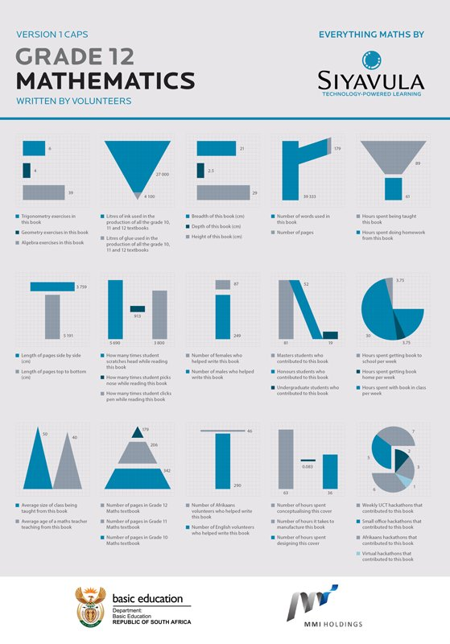
  - [Read online](/read/za/mathematics/grade-12)
  - Textbooks
    - Afrikaans
      - - [PDF (CC-BY-ND)](/downloads/books/maths/Gr12_Maths_Learner_Afr.pdf)
        - [ePUB (CC-BY-ND)](/downloads/books/maths/Gr12_Mathematics_Learner_Afr_CC-BY-ND.epub)
        - [ePUB (CC-BY)](/downloads/books/maths/Gr12_Mathematics_Learner_Afr_CC-BY.epub)
    - English
      - - [PDF (CC-BY-ND)](/downloads/books/maths/Gr12_Mathematics_Learner_Eng.pdf)
        - [ePUB (CC-BY-ND)](/downloads/books/maths/Gr12_Mathematics_Learner_Eng_CC-BY-ND.epub)
        - [ePUB (CC-BY)](/downloads/books/maths/Gr12_Mathematics_Learner_Eng_CC-BY.epub)
  - Teacher's guides
    - Afrikaans
      - - [PDF (CC-BY-ND)](/downloads/books/maths/Gr12_Maths_Teacher_Afr.pdf)
    - English
      - - [PDF (CC-BY-ND)](/downloads/books/maths/Gr12_Maths_Teacher_Eng.pdf)

## Physical Sciences

- 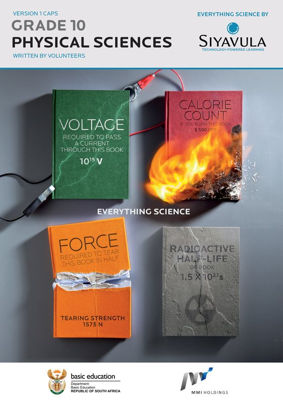
  - [Read online](/read/za/physical-sciences/grade-10)
  - Textbooks
    - Afrikaans
      - - [PDF (CC-BY-ND)](/downloads/books/science/Gr10_PhysicalSciences_Learner_Afr.pdf)
    - English
      - - [PDF (CC-BY-ND)](/downloads/books/science/Gr10_PhysicalSciences_Learner_Eng.pdf)
        - [ePUB (CC-BY-ND)](/downloads/books/science/Gr10_PhysicalSciences_Learner_Eng_CC-BY-ND.epub)
        - [ePUB (CC-BY)](/downloads/books/science/Gr10_PhysicalSciences_Learner_Eng_CC-BY.epub)
  - Teacher's guides
    - Afrikaans
      - - [PDF (CC-BY-ND)](/downloads/books/science/Gr10_PhysicalSciences_Teacher_Afr.pdf)
    - English
      - - [PDF (CC-BY-ND)](/downloads/books/science/Gr10_PhysicalSciences_Teacher_Eng.pdf)
- 
  - [Read online](/read/za/physical-sciences/grade-11)
  - Textbooks
    - Afrikaans
      - - [PDF (CC-BY-ND)](/downloads/books/science/Gr11_PhysicalSciences_Learner_Afr.pdf)
        - [ePUB (CC-BY-ND)](/downloads/books/science/Gr11_PhysicalSciences_Learner_Afr_CC-BY-ND.epub)
        - [ePUB (CC-BY)](/downloads/books/science/Gr11_PhysicalSciences_Learner_Afr_CC-BY.epub)
    - English
      - - [PDF (CC-BY-ND)](/downloads/books/science/Gr11_PhysicalSciences_Learner_Eng.pdf)
        - [ePUB (CC-BY-ND)](/downloads/books/science/Gr11_PhysicalSciences_Learner_Eng_CC-BY-ND.epub)
        - [ePUB (CC-BY)](/downloads/books/science/Gr11_PhysicalSciences_Learner_Eng_CC-BY.epub)
  - Teacher's guides
    - Afrikaans
      - - [PDF (CC-BY-ND)](/downloads/books/science/Gr11_PhysicalSciences_Teacher_Afr.pdf)
    - English
      - - [PDF (CC-BY-ND)](/downloads/books/science/Gr11_PhysicalSciences_Teacher_Eng.pdf)
- 
  - [Read online](/read/za/physical-sciences/grade-12)
  - Textbooks
    - Afrikaans
      - - [PDF (CC-BY-ND)](/downloads/books/science/Gr12_PhysicalSciences_Learner_Afr.pdf)
        - [ePUB (CC-BY-ND)](/downloads/books/science/Gr12_PhysicalSciences_Learner_Afr_CC-BY-ND.epub)
        - [ePUB (CC-BY)](/downloads/books/science/Gr12_PhysicalSciences_Learner_Afr_CC-BY.epub)
    - English
      - - [PDF (CC-BY-ND)](/downloads/books/science/Gr12_PhysicalSciences_Learner_Eng.pdf)
        - [ePUB (CC-BY-ND)](/downloads/books/science/Gr12_PhysicalSciences_Learner_Eng_CC-BY-ND.epub)
        - [ePUB (CC-BY)](/downloads/books/science/Gr12_PhysicalSciences_Learner_Eng_CC-BY.epub)
  - Teacher's guides
    - Afrikaans
      - - [PDF (CC-BY-ND)](/downloads/books/science/Gr12_PhysicalSciences_Teacher_Afr.pdf)
    - English
      - - [PDF (CC-BY-ND)](/downloads/books/science/Gr12_PhysicalSciences_Teacher_Eng.pdf)
- 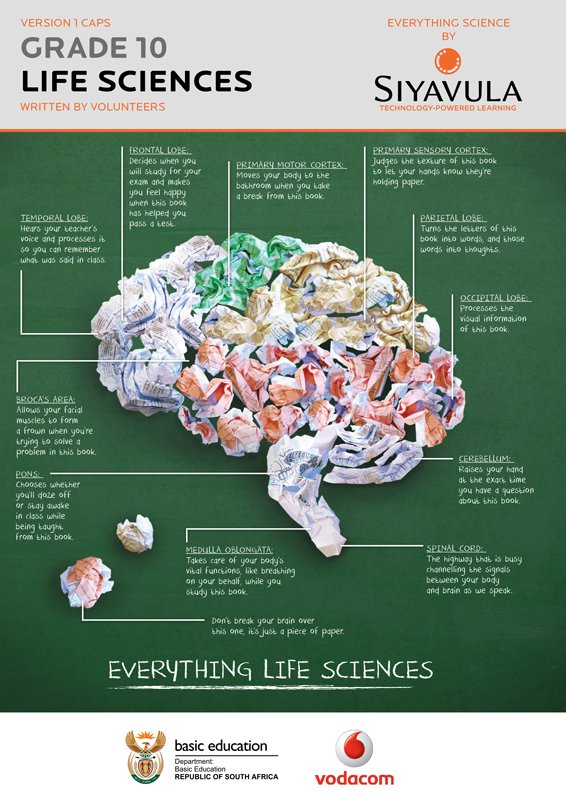
  - [Read online](/read/za/life-sciences/grade-10)
  - Textbooks
    - Afrikaans
      - - [PDF (CC-BY-ND)](/downloads/books/life-science/Gr10_LifeSciences_Learner_Afr.pdf)
        - [ePUB (CC-BY-ND)](/downloads/books/life-science/Gr10_LifeSciences_Learner_Afr_CC-BY-ND.epub)
        - [ePUB (CC-BY)](/downloads/books/life-science/Gr10_LifeSciences_Learner_Afr_CC-BY.epub)
    - English
      - - [PDF (CC-BY-ND)](/downloads/books/life-science/Gr10_LifeSciences_Learner_Eng.pdf)
        - [ePUB (CC-BY-ND)](/downloads/books/life-science/Gr10_LifeSciences_Learner_Eng_CC-BY-ND.epub)
        - [ePUB (CC-BY)](/downloads/books/life-science/Gr10_LifeSciences_Learner_Eng_CC-BY.epub)
  - Teacher's guides
    - Afrikaans
      - - [PDF (CC-BY-ND)](/downloads/books/life-science/Gr10_LifeSciences_Teacher_Afr.pdf)
    - English
      - - [PDF (CC-BY-ND)](/downloads/books/life-science/Gr10_LifeSciences_Teacher_Eng.pdf)
- 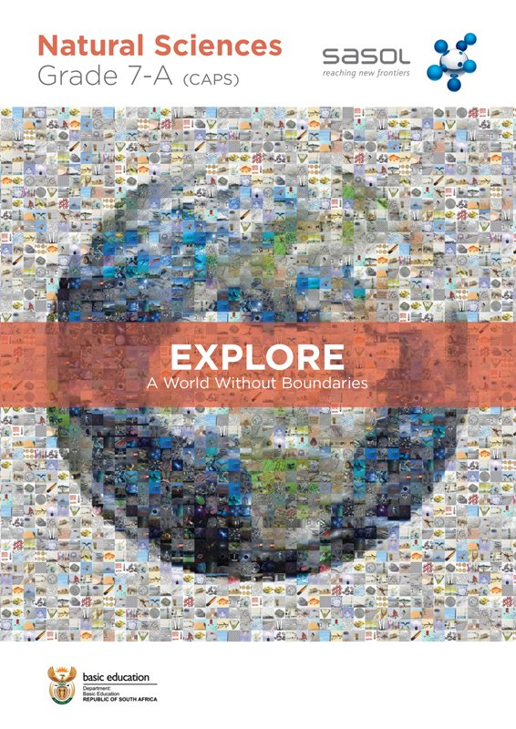
  - [Read online](/read/za/natural-sciences/grade-7)
  - Textbooks
    - Afrikaans
      - Graad 7A
        - [PDF (CC-BY-ND)](/downloads/books/science/Gr7_A_learner_afr.pdf)
      - Graad 7B
        - [PDF (CC-BY-ND)](/downloads/books/science/Gr7_B_learner_afr.pdf)
      - Graad 7 (A en B saam)
        - [ePUB (CC-BY-ND)](/downloads/books/science/Gr7_PhysicalSciences_Learner_Afr_CC-BY-ND.epub)
        - [ePUB (CC-BY)](/downloads/books/science/Gr7_PhysicalSciences_Learner_Afr_CC-BY.epub)
    - English
      - Grade 7A
        - [PDF (CC-BY-ND)](/downloads/books/science/Gr7_A_learner_eng.pdf)
      - Grade 7B
        - [PDF (CC-BY-ND)](/downloads/books/science/Gr7_B_learner_eng.pdf)
      - Grade 7 (A and B combined)
        - [ePUB (CC-BY-ND)](/downloads/books/science/Gr7_PhysicalSciences_Learner_Eng_CC-BY-ND.epub)
        - [ePUB (CC-BY)](/downloads/books/science/Gr7_PhysicalSciences_Learner_Eng_CC-BY.epub)
  - Teacher's guides
    - Afrikaans
      - Graad 7A
        - [PDF (CC-BY-ND)](/downloads/books/science/Gr7_A_teacher_afr.pdf)
      - Graad 7B
        - [PDF (CC-BY-ND)](/downloads/books/science/Gr7_B_teacher_afr.pdf)
    - English
      - Grade 7A
        - [PDF (CC-BY-ND)](/downloads/books/science/Gr7_A_teacher_eng.pdf)
      - Grade 7B
        - [PDF (CC-BY-ND)](/downloads/books/science/Gr7_B_teacher_eng.pdf)
- 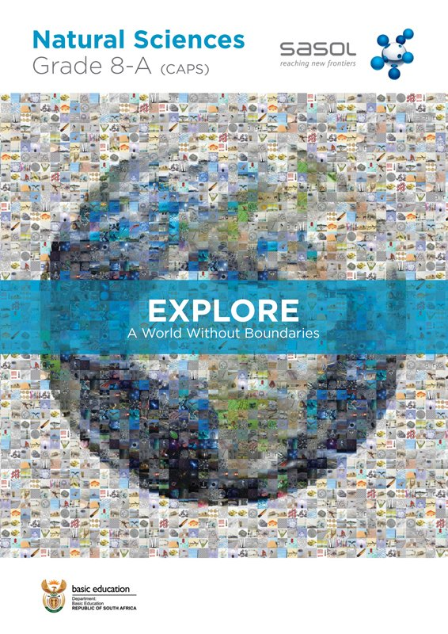
  - [Read online](/read/za/natural-sciences/grade-8)
  - Textbooks
    - Afrikaans
      - Graad 8A
        - [PDF (CC-BY-ND)](/downloads/books/science/Gr8_A_learner_afr.pdf)
      - Graad 8B
        - [PDF (CC-BY-ND)](/downloads/books/science/Gr8_B_learner_afr.pdf)
      - Graad 8 (A en B saam)
        - [ePUB (CC-BY-ND)](/downloads/books/science/Gr8_PhysicalSciences_Learner_Afr_CC-BY-ND.epub)
        - [ePUB (CC-BY)](/downloads/books/science/Gr8_PhysicalSciences_Learner_Afr_CC-BY.epub)
    - English
      - Grade 8A
        - [PDF (CC-BY-ND)](/downloads/books/science/Gr8_A_learner_eng.pdf)
      - Grade 8B
        - [PDF (CC-BY-ND)](/downloads/books/science/Gr8_B_learner_eng.pdf)
      - Grade 8 (A and B combined)
        - [ePUB (CC-BY-ND)](/downloads/books/science/Gr8_PhysicalSciences_Learner_Eng_CC-BY-ND.epub)
        - [ePUB (CC-BY)](/downloads/books/science/Gr8_PhysicalSciences_Learner_Eng_CC-BY.epub)
  - Teacher's guides
    - Afrikaans
      - Graad 8A
        - [PDF (CC-BY-ND)](/downloads/books/science/Gr8_A_teacher_afr.pdf)
      - Graad 8B
        - [PDF (CC-BY-ND)](/downloads/books/science/Gr8_B_teacher_afr.pdf)
    - English
      - Grade 8A
        - [PDF (CC-BY-ND)](/downloads/books/science/Gr8_A_teacher_eng.pdf)
      - Grade 8B
        - [PDF (CC-BY-ND)](/downloads/books/science/Gr8_B_teacher_eng.pdf)
- 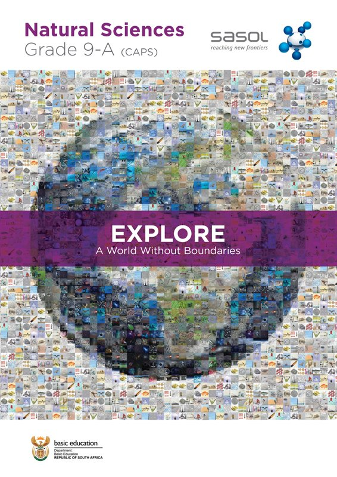
  - [Read online](/read/za/natural-sciences/grade-9)
  - Textbooks
    - Afrikaans
      - Graad 9A
        - [PDF (CC-BY-ND)](/downloads/books/science/Gr9_A_learner_afr.pdf)
      - Graad 9B
        - [PDF (CC-BY-ND)](/downloads/books/science/Gr9_B_learner_afr.pdf)
      - Graad 9 (A en B saam)
        - [ePUB (CC-BY-ND)](/downloads/books/science/Gr9_PhysicalSciences_Learner_Afr_CC-BY-ND.epub)
        - [ePUB (CC-BY)](/downloads/books/science/Gr9_PhysicalSciences_Learner_Afr_CC-BY.epub)
    - English
      - Grade 9A
        - [PDF (CC-BY-ND)](/downloads/books/science/Gr9_A_learner_eng.pdf)
      - Grade 9B
        - [PDF (CC-BY-ND)](/downloads/books/science/Gr9_B_learner_eng.pdf)
      - Grade 9 (A and B combined)
        - [ePUB (CC-BY-ND)](/downloads/books/science/Gr9_PhysicalSciences_Learner_Eng_CC-BY-ND.epub)
        - [ePUB (CC-BY)](/downloads/books/science/Gr9_PhysicalSciences_Learner_Eng_CC-BY.epub)
  - Teacher's guides
    - Afrikaans
      - Graad 9A
        - [PDF (CC-BY-ND)](/downloads/books/science/Gr9_A_teacher_afr.pdf)
      - Graad 9B
        - [PDF (CC-BY-ND)](/downloads/books/science/Gr9_B_teacher_afr.pdf)
    - English
      - Grade 9A
        - [PDF (CC-BY-ND)](/downloads/books/science/Gr9_A_teacher_eng.pdf)
      - Grade 9B
        - [PDF (CC-BY-ND)](/downloads/books/science/Gr9_B_teacher_eng.pdf)
- 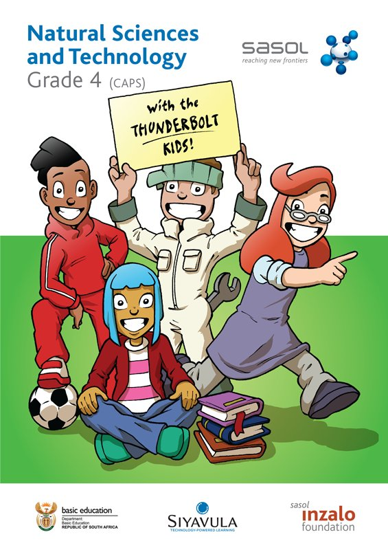
  - [Read online](http://www.thunderboltkids.co.za/grade-4.html)
  - Textbooks
    - Afrikaans
      - Graad 4A
        - [PDF (CC-BY-ND)](/downloads/books/science/Gr4A_NaturalSciences_Learner_Afr.pdf)
      - Graad 4B
        - [PDF (CC-BY-ND)](/downloads/books/science/Gr4B_NaturalSciences_Learner_Afr.pdf)
      - Graad 4 (A en B saam)
        - [ePUB (CC-BY-ND)](/downloads/books/science/Gr4_NaturalSciences_Learner_Afr_CC-BY-ND.epub)
        - [ePUB (CC-BY)](/downloads/books/science/Gr4_NaturalSciences_Learner_Afr_CC-BY.epub)
    - English
      - Grade 4A
        - [PDF (CC-BY-ND)](/downloads/books/science/Gr4A_NaturalSciences_Learner_Eng.pdf)
      - Grade 4B
        - [PDF (CC-BY-ND)](/downloads/books/science/Gr4B_NaturalSciences_Learner_Eng.pdf)
      - Grade 4 (A and B combined)
        - [ePUB (CC-BY-ND)](/downloads/books/science/Gr4_NaturalSciences_Learner_Eng_CC-BY-ND.epub)
        - [ePUB (CC-BY)](/downloads/books/science/Gr4_NaturalSciences_Learner_Eng_CC-BY.epub)
  - Teacher's guides
    - Afrikaans
      - Graad 4A
        - [PDF (CC-BY-ND)](/downloads/books/science/Gr4A_NaturalSciences_Teacher_Afr.pdf)
      - Graad 4B
        - [PDF (CC-BY-ND)](/downloads/books/science/Gr4B_NaturalSciences_Teacher_Afr.pdf)
    - English
      - Grade 4A
        - [PDF (CC-BY-ND)](/downloads/books/science/Gr4A_NaturalSciences_Teacher_Eng.pdf)
      - Grade 4B
        - [PDF (CC-BY-ND)](/downloads/books/science/Gr4B_NaturalSciences_Teacher_Eng.pdf)
- 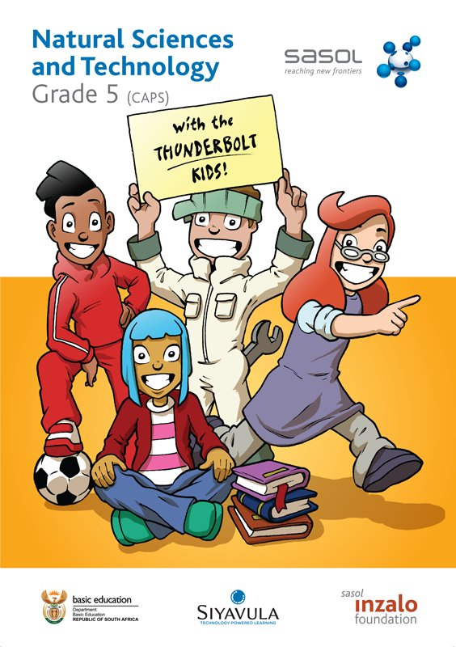
  - [Read online](http://www.thunderboltkids.co.za/grade-5.html)
  - Textbooks
    - Afrikaans
      - Graad 5A
        - [PDF (CC-BY-ND)](/downloads/books/science/Gr5A_NaturalSciences_Learner_Afr.pdf)
      - Graad 5B
        - [PDF (CC-BY-ND)](/downloads/books/science/Gr5B_NaturalSciences_Learner_Afr.pdf)
      - Graad 5 (A en B saam)
        - [ePUB (CC-BY-ND)](/downloads/books/science/Gr5_NaturalSciences_Learner_Afr_CC-BY-ND.epub)
        - [ePUB (CC-BY)](/downloads/books/science/Gr5_NaturalSciences_Learner_Afr_CC-BY.epub)
    - English
      - Grade 5A
        - [PDF (CC-BY-ND)](/downloads/books/science/Gr5A_NaturalSciences_Learner_Eng.pdf)
      - Grade 5B
        - [PDF (CC-BY-ND)](/downloads/books/science/Gr5B_NaturalSciences_Learner_Eng.pdf)
      - Grade 5 (A and B combined)
        - [ePUB (CC-BY-ND)](/downloads/books/science/Gr5_NaturalSciences_Learner_Eng_CC-BY-ND.epub)
        - [ePUB (CC-BY)](/downloads/books/science/Gr5_NaturalSciences_Learner_Eng_CC-BY.epub)
  - Teacher's guides
    - Afrikaans
      - Graad 5A
        - [PDF (CC-BY-ND)](/downloads/books/science/Gr5A_NaturalSciences_Teacher_Afr.pdf)
      - Graad 5B
        - [PDF (CC-BY-ND)](/downloads/books/science/Gr5B_NaturalSciences_Teacher_Afr.pdf)
    - English
      - Grade 5A
        - [PDF (CC-BY-ND)](/downloads/books/science/Gr5A_NaturalSciences_Teacher_Eng.pdf)
      - Grade 5B
        - [PDF (CC-BY-ND)](/downloads/books/science/Gr5B_NaturalSciences_Teacher_Eng.pdf)
- 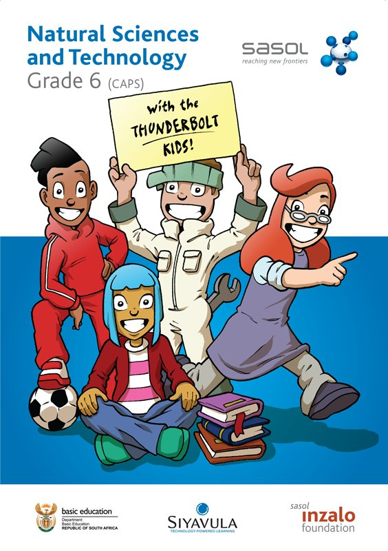
  - [Read online](http://www.thunderboltkids.co.za/grade-6.html)
  - Textbooks
    - Afrikaans
      - Graad 6A
        - [PDF (CC-BY-ND)](/downloads/books/science/Gr6A_NaturalSciences_Learner_Afr.pdf)
      - Graad 6B
        - [PDF (CC-BY-ND)](/downloads/books/science/Gr6B_NaturalSciences_Learner_Afr.pdf)
      - Graad 6 (A en B saam)
        - [ePUB (CC-BY-ND)](/downloads/books/science/Gr6_NaturalSciences_Learner_Afr_CC-BY-ND.epub)
        - [ePUB (CC-BY)](/downloads/books/science/Gr6_NaturalSciences_Learner_Afr_CC-BY.epub)
    - English
      - Grade 6A
        - [PDF (CC-BY-ND)](/downloads/books/science/Gr6A_NaturalSciences_Learner_Eng.pdf)
      - Grade 6B
        - [PDF (CC-BY-ND)](/downloads/books/science/Gr6B_NaturalSciences_Learner_Eng.pdf)
      - Grade 6 (A and B combined)
        - [ePUB (CC-BY-ND)](/downloads/books/science/Gr6_NaturalSciences_Learner_Eng_CC-BY-ND.epub)
        - [ePUB (CC-BY)](/downloads/books/science/Gr6_NaturalSciences_Learner_Eng_CC-BY.epub)
  - Teacher's guides
    - Afrikaans
      - Graad 6A
        - [PDF (CC-BY-ND)](/downloads/books/science/Gr6A_NaturalSciences_Teacher_Afr.pdf)
      - Graad 6B
        - [PDF (CC-BY-ND)](/downloads/books/science/Gr6B_NaturalSciences_Teacher_Afr.pdf)
    - English
      - Grade 6A
        - [PDF (CC-BY-ND)](/downloads/books/science/Gr6A_NaturalSciences_Teacher_Eng.pdf)
      - Grade 6B
        - [PDF (CC-BY-ND)](/downloads/books/science/Gr6B_NaturalSciences_Teacher_Eng.pdf)

## Computer Applications Technology

- 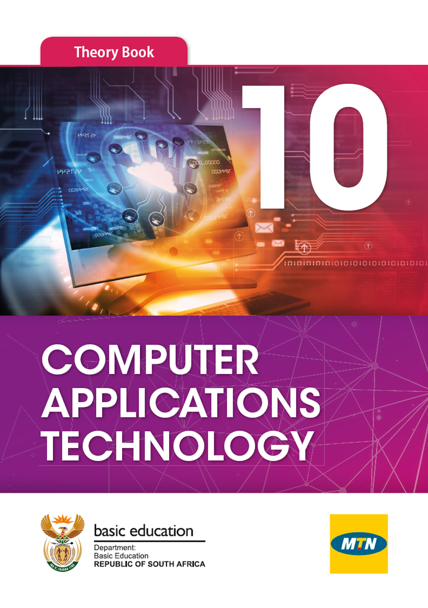
  - [Read online](/read/za/computer-applications-technology/grade-10)
  - Textbook
    - English
      - - [ePUB (Closed copyright)](/downloads/books/cat/CAT_theory_book_grade10.epub)
  - Teacher's guide
    - English
      - - [ePUB (Closed copyright)](/downloads/books/cat/CAT_teachers_guide_grade10.epub)
  - Practical book
    - English
      - - [ePUB (Closed copyright)](/downloads/books/cat/CAT_practical_book_grade10.epub)
  - Data files
    - English
      - - [Data files (Closed copyright)](/downloads/books/cat/CAT_teachers_guides_data_files_grade_10.zip)
- 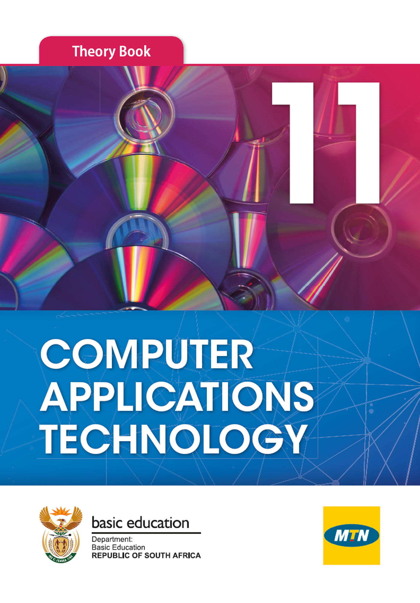
  - [Read online](/read/za/computer-applications-technology/grade-11)
  - Textbook
    - English
      - - [ePUB (Closed copyright)](/downloads/books/cat/CAT_theory_book_grade11.epub)
  - Teacher's guide
    - English
      - - [ePUB (Closed copyright)](/downloads/books/cat/CAT_teachers_guide_grade11.epub)
  - Practical book
    - English
      - - [ePUB (Closed copyright)](/downloads/books/cat/CAT_practical_book_grade11.epub)
  - Data files
    - English
      - - [Data files (Closed copyright)](/downloads/books/cat/CAT_teachers_guides_data_files_grade_11.zip)
- 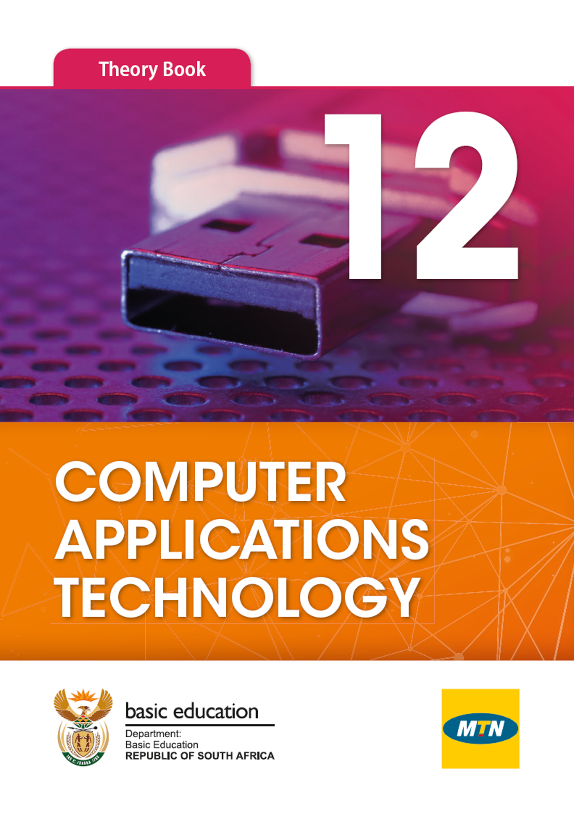
  - [Read online](/read/za/computer-applications-technology/grade-12)
  - Textbook
    - English
      - - [ePUB (Closed copyright)](/downloads/books/cat/CAT_theory_book_grade12.epub)
  - Teacher's guide
    - English
      - - [ePUB (Closed copyright)](/downloads/books/cat/CAT_teachers_guide_grade12.epub)
  - Practical book
    - English
      - - [ePUB (Closed copyright)](/downloads/books/cat/CAT_practical_book_grade12.epub)
  - Data files
    - English
      - - [Data files (Closed copyright)](/downloads/books/cat/CAT_teachers_guides_data_files_grade_12.zip)

## Information Technology

- 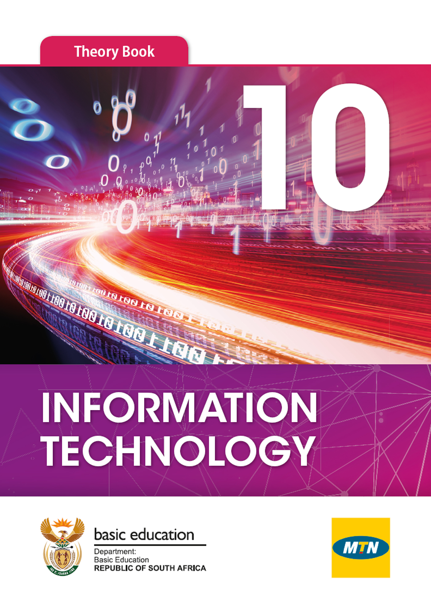
  - [Read online](/read/za/information-technology/grade-10)
  - Textbook
    - English
      - - [ePUB (Closed copyright)](/downloads/books/it/IT_theory_book_grade10.epub)
  - Teacher's guide
    - English
      - - [ePUB (Closed copyright)](/downloads/books/it/IT_teachers_guide_grade10.epub)
  - Practical book
    - English
      - - [ePUB (Closed copyright)](/downloads/books/it/IT_practical_book_grade10.epub)
  - Data files
    - English
      - - [Data files (Closed copyright)](/downloads/books/it/IT_teachers_guides_data_files_grade10.zip)
- 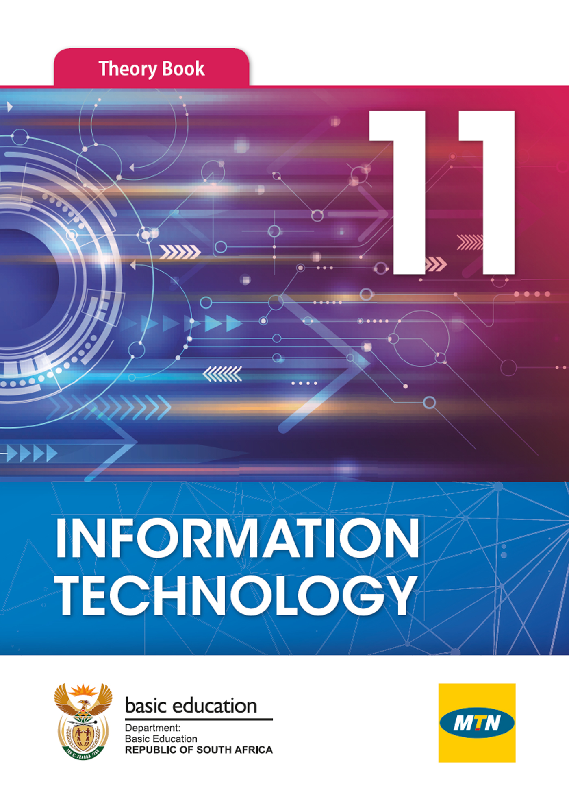
  - [Read online](/read/za/information-technology/grade-11)
  - Textbook
    - English
      - - [ePUB (Closed copyright)](/downloads/books/it/IT_theory_book_grade11.epub)
  - Teacher's guide
    - English
      - - [ePUB (Closed copyright)](/downloads/books/it/IT_teachers_guide_grade11.epub)
  - Practical book
    - English
      - - [ePUB (Closed copyright)](/downloads/books/it/IT_practical_book_grade11.epub)
  - Data files
    - English
      - - [Data files (Closed copyright)](/downloads/books/it/IT_teachers_guides_data_files_grade11.zip)
- 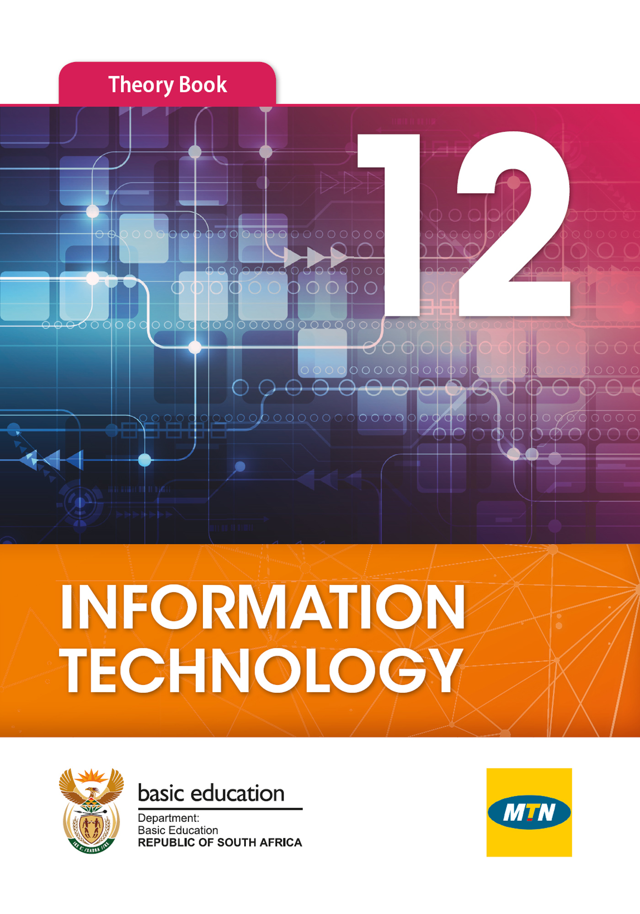
  - [Read online](/read/za/information-technology/grade-12)
  - Textbook
    - English
      - - [ePUB (Closed copyright)](/downloads/books/it/IT_theory_book_grade12.epub)
  - Teacher's guide
    - English
      - - [ePUB (Closed copyright)](/downloads/books/it/IT_teachers_guide_grade12.epub)
  - Practical book
    - English
      - - [ePUB (Closed copyright)](/downloads/books/it/IT_practical_book_grade12.epub)
  - Data files
    - English
      - - [Data files (Closed copyright)](/downloads/books/it/IT_teachers_guides_data_files_grade12.zip)

## Our book licensing

Better than just free, these books (except Information Technology and Computer Applications Technology) are also openly-licensed! The same content, but different versions (branded or not) have different licenses, as explained:

### CC-BY-ND (branded versions)

You are allowed and encouraged to freely copy these versions. You can photocopy, print and distribute them as often as you like. You can download them onto your mobile phone, iPad, PC or flash drive. You can burn them to CD, email them around or upload them to your website. The only restriction is that you cannot adapt or change these versions of the textbooks, their content or covers in any way as they contain the relevant Siyavula brands, the sponsorship logos and are endorsed by the Department of Basic Education. For more information, visit [Creative Commons Attribution-NoDerivs 3.0 Unported](http://creativecommons.org/licenses/by-nd/3.0/).

Find out more [here](https://www.siyavulafoundation.org/about-us) about the sponsorships and partnerships with others that made the production of each of the open textbooks possible.

### CC-BY (unbranded versions)

These unbranded versions of the same content are available for you to share, adapt, transform, modify or build upon in any way, with the only requirement being to give appropriate credit to Siyavula. For more information, visit [Creative Commons Attribution 3.0 Unported](http://creativecommons.org/licenses/by/3.0/).

### Information Technology and Computer Applications Technology

These books have been provided by MTN and are under a closed copyright license.
