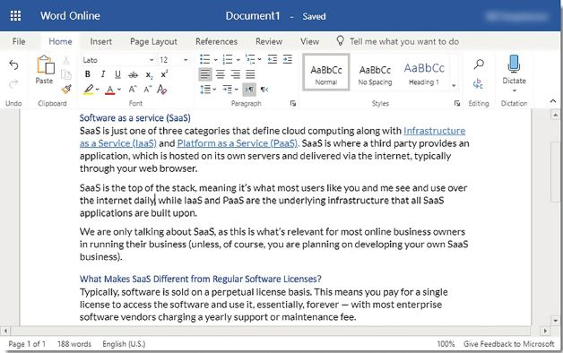

## UNIT 6.1 Cloud computing

Cloud computing refers to the process in which computers on the Internet (rather than local computers) are used to store, manage and process data.

Cloud computing can also be used to run applications (or services) on the Internet like Google Docs and Microsoft’s Office 365. Cloud computing has made it easier and cheaper to host a website with 100% uptime.

Cloud computing offers several significant advantages to users:

- **Scalable**: Cloud computing is perfectly scalable, which means that the capacity of your virtual machine will grow automatically as your requirements increase.
- **Affordable**: A single virtual machine is affordable, and it only becomes expensive once you need to rent large numbers of virtual machines.
- **Reliable**: Many cloud computing companies guarantee that the machine will be available to users always.
- **Fast**: Cloud computers and the Internet connection to these computers can be incredibly fast.
- **Maintained**: The servers used for cloud computing are maintained by an expert team who ensure they continue running efficiently.

Thanks to these advantages, most websites and web applications make use of cloud computers to host their websites.

Each client only pays for the small part of the server they need.

**Figure 6.1:** ***Data centres can contain hundreds of powerful servers***

#### EFFECT ON HARDWARE NEEDS

Cloud computing infrastructure includes server hardware and software, storage, networking, adequate cooling and security for access control. This can be quite expensive to set up and maintain. Nowadays most businesses are moving the support and administration of servers to the cloud as cloud servers are available anywhere there is an Internet connection.

The virtual servers are built on large hardware platforms so that they can scale up or down quickly. This is helpful for businesses whos computing infrastructures changes frequently.

QR CODE

[https://www.youtube.com/watch?v=XZmGGAbHqa0](https://www.youtube.com/watch?v=XZmGGAbHqa0)

***[https://qrs.ly/8qa5pii](https://qrs.ly/8qa5pii)***

Businesses are becoming more reliant on cloud-based resources and less dependent on traditional IT hardware and software assets. Businesses employ a hosting provider to manage the hardware and they can focus on the software.

In the past companies ran multiple operating systems on virtual machines and the servers were often used at 20% to 30% of capacity. Recently with cloud computing, on-premise hardware will share computing power with a cloud computing service provider for a monthly subscription fee. This results in companies doubling the amount of capacity they get with their hardware. Therefore, there is less need for the purchasing of new servers and hardware.

One negative effect is downtime. For example, when businesses maintain their servers, it causes the system to be out of action or unavailable for use.

#### SOFTWARE AS A SERVICE (SAAS)

SaaS (or Software as a Service) refers to applications that are hosted on the cloud and that users pay a monthly subscription to access. As the name suggests, SaaS is based on the idea that many software applications present a service to users. This service might be to provide entertainment, increase productivity or improve communication.

With SaaS, applications are run on cloud computers and users access these applications through their web browsers, without any of the applications being installed on their local computer. This works by a cloud computer in the background performing all the tasks and simply showing the user interface in the web browser.

Advantages of SAAS

- minimal setup required.
- minimal initial cost.
- software is updated automatically on the cloud computers.
- new features are regularly added.
- can be used from any computer with an Internet connection.
- easier to collaborate or share information with other users.

 **Case Study** Microsoft Office 2019 vs Microsoft Office 365

Microsoft Office 365 is a service that users subscribe to. Every month or year, users pay a small subscription fee (between 3% and 5% of Microsoft Office price). Once subscribed, users can download and install all the same Microsoft Office applications on their computer and between 2 and 5 other devices, use the online versions of the applications through their web browser, and store up to 1 TB of files on Microsoft OneDrive.

**Figure 6.2:** ***Word 365 can be used as a web application***

Users who are subscribed to Office 365 are given access to the newest version of Microsoft Office.

The online versions of Office 365 make use of cloud computers to run the software applications, and these computers are paid for using a part of the users’ monthly subscription fees.

It is important to note that, with SaaS, the subscriber does not own the software, he or she is simply renting it. As a result, once the SaaS subscriber stops paying their subscription fee, they lose access to the software. The subscriber does, however, own any work created using the software even if this information is stored on a cloud service.

 Activity 6.1 **Cloud computing**

**6.1.1**List the advantages cloud computing has for its users.

**6.1.2**Create a debate for and against cloud computing. Include the effects on hardware and advantages or disadvantages on businesses

**6.1.3**Itumeleng is a young writer who recently started working for a large newspaper. On the first day of work, he received a work laptop that he could use to write articles for the newspaper. According to his supervisor, the company has recently started using cloud applications for most of their work, especially for the work of writers and editors.Based on this information, answer the following questions.

**a.**Explain in your own words what SaaS is.

**b.**Besides Office 365, research and give two examples of SaaS (software as a service).

**c.**What software do you need to have installed to use SaaS?

**d.**What are three advantages for a company to use SaaS over a normal software application?
