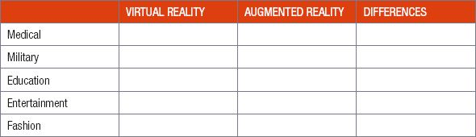

## UNIT 6.4 Virtualisation

Virtualisation refers to running multiple computing environments (called virtual machines) on a single set of hardware.

Did you know

Even though they are often mentioned together, virtualisation is different from cloud computing. Virtualisation is the software that allows you to create hundreds of virtual machines on a single virtual server, while cloud computing is the service that uses virtualisation to rent out small parts of a server. Virtualisation is therefore the software, while cloud computing is the product sold to consumers.

On very old operating systems, you could only load and run one program into the computer’s memory at a time! However, modern processing techniques allow you to use your CPU more effectively. These processing techniques are:

- **Multitasking**: With multitasking, a single processor splits its time between different processes.
- **Multithreading**: Multithreading completes the instructions for multiple different tasks inside the same program (called threads) by quickly switching between them.
- **Multiprocessing**: Multiprocessing uses many processors to complete tasks.

These techniques are heavily used in virtualisation, where a single computer can be broken into many ‘virtual machines’. Each virtual machine is allocated its own CPU, RAM and storage space and are treated in the same way as a real computer. This means that each virtual machine must have its own operating system and its own applications installed, and that the different virtual machines do not have access to the main computer or any of the other virtual machines.

Animation

Animation showing how a single data centre server is broken into small pieces, with each of these pieces connecting to a different user on the Internet. The goal is to show how cloud computing works by breaking servers into hundreds of smaller virtual machines.

#### USES OF VIRTUALISATION

Virtualisation has many different uses, including testing different operating systems and software, cloning computers, hosting cloud applications and allow multiple people to use the same computer at the same time.

BENEFITS

- **Less expenditure:** servers, storage and desktops, virtualisation can release assets, saving in capital and operational expenditure. It can reduce the number of software licences that are needed.
- **Save assets:** server virtualisation supports multiple applications to operate on a single physical server, enabling the same assets to be better utilised.
- **Disaster recovery:** options include building in high availability and disaster recovery processes without replicating everything. The automation embedded in virtualisation tools supports management processes. It does not replace them. After all, if systems fail, administrators rely on management tools to identify where the problems are.
- **Green IT:** with fewer server and storage resources, the demand for power and cooling can be reduced and there will be fewer units to dispose of.
- **Long-term benefits:** virtualisation starts to change the basic infrastructure, saving money and establishing a new foundation for on-going developments. The IT team can show it has answers to help reduce operating costs and show how every employee can make a contribution to reducing greenhouse gases.

 Activity 6.4

**6.4.1**Choose the correct answer.

**a.**The following techniques are used in virtualisation:

**A.**Multithreading

**B.**Multiprocessing

**C.**Multitasking

**D.**All of the above

**b.**This completes the instructions for multiple different tasks inside the same program (called threads) by quickly switching between them.

**A.**Multithreading

**B.**Multiprocessing

**C.**Multitasking

**D.**None of the above

**c.**It uses multiple processors to complete tasks.

**A.**Multithreading

**B.**Multiprocessing

**C.**Multitasking

**D.**None of the above

**d.**The difference between virtualisation and cloud computing is:

**A.**Cloud computing is the software, while virtualisation is the product sold to consumers

**B.**Virtualisation is the software, while cloud computing is the product sold to consumers

**C.**Virtualisation is the software, while cloud computing is based on the idea that many software applications present a service to users.

**D.**None of the above.

**e.**Virtualisation is one of the core technologies used in_____.

**6.4.2**List at least THREE uses of virtualisation.

CONSOLIDATION ACTIVITY Chapter 6: Software

**1.**Create two groups to debate which is better Virtual Reality or Augmented Reality.

**2.  a.**Complete the table by giving an example for each field.

**b.**Compare the uses of Virtual and Augmented Reality.
