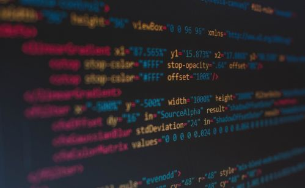

## UNIT 7.1 Computer criminals

You have already learned how to keep your computer safe from malicious software. You have also seen the techniques websites use to help keep you safe. So, in this final section on computer security, you will look at the different types of computer criminals and the targets of their attacks in greater detail.

**Figure 7.1:** ***Cyber-criminals use their computer skills to gain access to data***

#### HACKERS

A hacker is anyone who uses their computer skills to gain unauthorised access to computer systems or data. They can do this through a combination of exploits, scripts and social engineering.

TYPES OF HACKERS

**White hat hackers** help companies improve their security by trying to hack into their computers.

**Black hat hackers** illegally break into computer systems.

#### CRACKERS

Cracker refers to Individuals who use their skills illegally. They may break into computer systems for a variety of reasons, from stealing data to testing their skills to making political statements.

The word cracker can also be used to refer to people who write software cracks (tools that allow software to be pirated and used illegally).

#### CER GANGS

A cyber gang, much like a gang in real life, is a group of people who work together to commit computer crimes. Just like in real life gangs, these gangs can be made up of many loosely organised members.

#### VIRUS AUTHOR

A virus author is any person who writes a computer virus. Virus authors create viruses for several reasons, including causing damage, showing off their skills, gaining information or money or taking over computers and using them to send spam emails.

Many security experts will argue that calling a hacker a criminal is also incorrect since many hackers do not use their computer skills for illegal purposes but are instead paid by companies to test their security systems.
