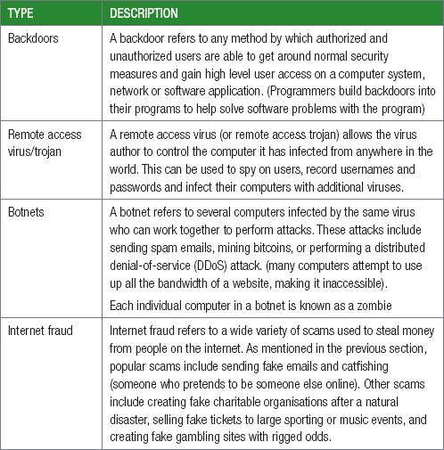

## UNIT 7.2 Types of cyber crimes

In Grade 10 and 11 you learned about different types of computer viruses and malware attacks. The table below describes five new types of attacks that you should be aware of:

 Activity 7.1

**7.1.1**In small groups discuss the types of crimes, the criminals’ reasons for committing the crimes and the consequences.

**7.1.2**Choose one type of cybercrime and research a case study on the crime. Ask your peers questions on the case study in order to gain further knowledge.
