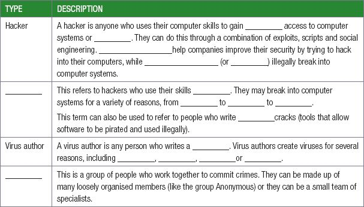
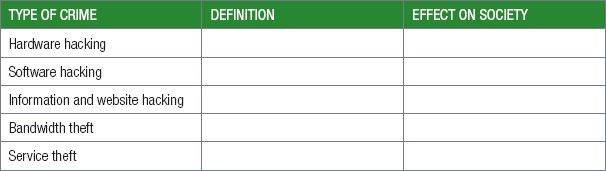

## UNIT 7.5 Safeguards against computer crimes, threats and criminals

Cyber/Computer crime cannot be stopped completely. But sometimes it can be prevented with practicing good online safety habits. Several methods can be used to safeguard against computer crimes, threats and criminals.

- Make sure your security software is current – and update it regularly for protection from malware, viruses and other online threats.
- Lock or log off your computer when you step away to ensure that no one else will have access to all your information.
- Go offline when you don’t need an internet connection to reduce the chances of hackers and virus scans Invading your computer.
- Take advantage of security settings by using PINs or passcodes to protect someone from easily accessing all your information.
- Consider sharing less online. Your birthdate and the city where you live on your social media profiles can give criminals a more complete picture and make it easier for them to steal your identity.
- Think twice about using public Wi-Fi. Avoid entering private information and using apps that have passwords when you are on public Wi-Fi.
- Delete tweets, posts and online advertising, in addition to emails, if it looks suspicious.

CONSOLIDATION ACTIVITY Chapter 7: Social implications

**1.**Without looking at your notes, complete the sentences on the different type of computer criminals.

**2.**Complete the table on the types of cybercrimes.

Which type of crime do you think is the worst and why?

**3.**Explain three safeguards you can put in place to protect your device. Do you follow these safeguards? Explain.
