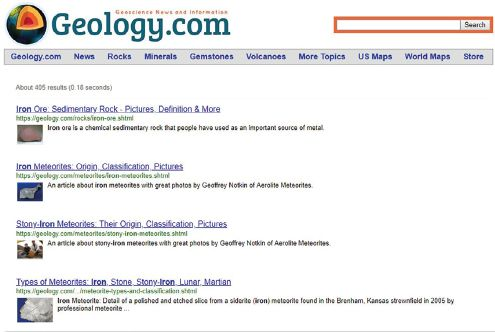

## UNIT 8.1 Improve searching

The smart internet search engines have changed from simply searching for keywords to answering natural language questions, often before they are even asked!

Search engines used to work by searching for specific words (or keywords) in the text of web pages. This type of search is known as keyword search and is a reasonably good way to search for information. Combined with an effective ranking system, keyword search will show you the most useful websites containing your keywords.

However, keyword searches struggle to answer questions. Since the keyword search does not know what the individual words mean, all it can do is to look for pages where those keywords are found on the page. As a result, the search results often include pages containing the keywords that are unrelated to the question being asked. Searches may also fail to find web pages that do answer the question but use different keywords.

In the following sections, you will see how improvements to semantic search and mediated search hopes to improve your search results.

#### SEMANTIC SEARCH

Semantic refers to the meaning of words and sentences, a semantic search engine is a search engine that searches for answers based on the meaning of the search, rather than on the keywords (i.e improve **search** accuracy by understanding a searcher›s intent through contextual meaning)

If you search for: ‘What is the semantic web? then a semantic search engine will attempt to answer this question (and show definitions, articles and advantages, advantages of the semantic web), while a keyword search engine will show you web pages containing the words ‘What’, ‘is’, ‘the’, ‘semantic’ and ‘web’

#### MEDIATED SEARCH

Disagreements are mediated, that means a neutral person has stepped in to help. Most websites provide a search facility within the site. Rather than each website creating their own, basic search engine, mediate search allows websites to make use of an advanced search engine like Google to power search their website. When a user enters a search query, it runs the query through a search engine like Google or Bing but limits the results to the specific website. These results can then be shown directly inside the web page, like any other search query would be. This allows small website creators to use the most powerful search engines in the world on their website.

**Figure 8.1:** ***[Geology.com](http://www.Geology.com) makes use of mediated search***

#### SEO (SEARCH ENGINE OPTIMIZATION)

SEO is the practice of increasing the quantity and quality of traffic to your website through search engine results. A search engine has a crawler (systematically browsers the WWW) that gathers information available on the Internet. The crawlers bring that data back to the search engine in order to build an index. When you type in a query or phrase in the search engine, it tries to match all that data using an algorithm. The index is then fed through that algorithm and a long list of links to webpages that could potentially answer your question is provided.

 Activity 8.2 **Using search engines**

**8.2.1**Choose the correct answer.

The following are different methods of searching information on the Internet.

**a.**Combined with an effective ranking system, this type of search engine will show you the most useful websites containing your keywords. It can however not answer questions.

**A.**Semantic search

**B.**Mediated search

**C.**Keyword search

**D.**None of the above

**b.**This type of search engine searches for answers based on the meaning of the search, rather than on the keywords.

**A.**Semantic search

**B.**Mediated search

**C.**Keyword search

**c.**This type of search engine allows websites to make use of an advanced search engine like Google to power searches on their website.

**A.**Semantic search

**B.**Mediated search

**C.**Keyword search

**d.**The following improvements have been made by Google to become closer to search engines, namely automatically correcting spelling mistakes, using natural language and learning from other people’s searches.

**A.**Semantic search

**B.**Mediated search

**C.**Keyword search

**e.**When a user enters a search query, it runs the query through a search engine like Google or Bing but limits the results to the specific website. These results can then be shown directly inside the web page, like any other search query would be. This is how _____ works.

**A.**Semantic search

**B.**Mediated search

**C.**Keyword search

**8.2.2**Individually or in pairs, use a web search to find answers to the following questions:

**a.**What is the name and height of the tallest mountain in South Africa?

**b.**On which day was Nelson Mandela born?

**c.**Who is the current world chess champion?

**d.**What is the best-selling album of all time?

**e.**Which movie did the best of the box office this year?

**8.2.3**Individually or in your pairs, do online research to find answers to the questions below. You will need to look at more than one website.

**a.**What is the best price for a GeForce RX 2080 8GB? At which shop did you find this price?

**b.**Which South African musician or band has sold the most albums?

**c.**Which celebrity popularised the Adidas Ultra Boost sneakers?

**d.**Which YouTuber has the most subscribers?

**8.2.4**Individually or in your pairs, do online research to answer the following questions. For each of the questions, give reasons for your answer.

**a.**What is the best smartphone of the year? How much does it cost in South Africa?

**b.**What is the best budget smartphone currently available? Is it available in South Africa? What is the best price you can find for this smartphone?

**c.**Does the Xiaomi M8 smartphone work on South African mobile networks?

**8.2.5**Individually or in your pairs, create a presentation or report containing your answers to the questions from the three practical activities (2 to 4). For each question, state the following:

**a.**The answer to each question

**b.** The website where you found the answer

**c.**How difficult it was to find an answer.

Once prepared, present your answers to the rest of the class or submit your report to your teacher.
