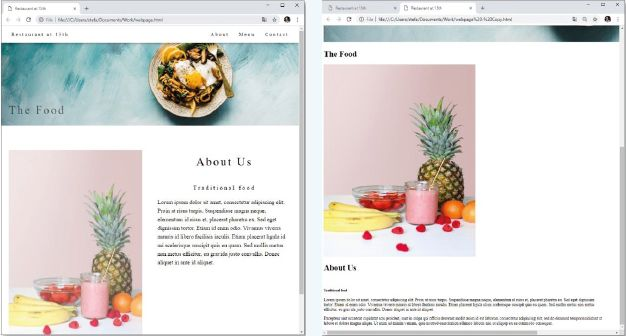
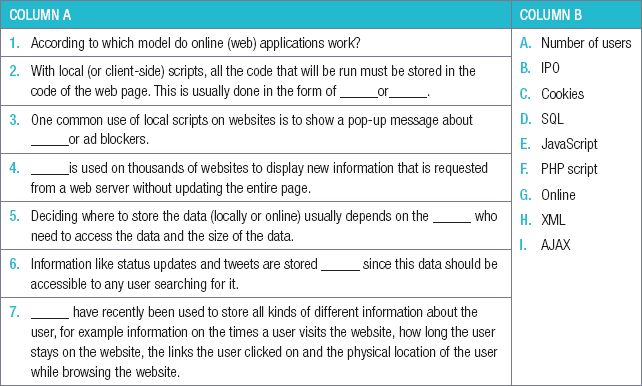
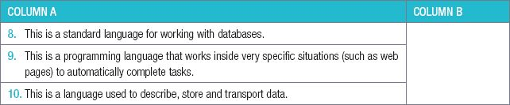
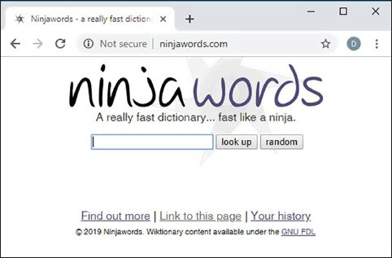
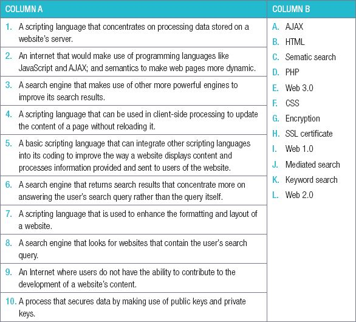
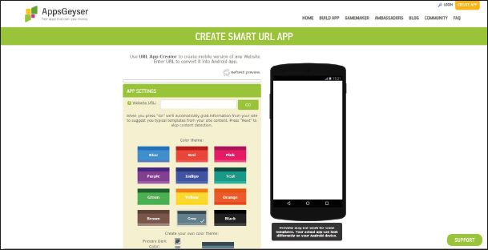

## UNIT 8.2 Online applications

Online (web) applications work using the IPO model of input, processing, storage and output. In this section, you will learn about three of these steps, namely:

- how data is stored,
- how instructions are run (or processed) and
- how the output is formatted.

#### STORING DATA

Deciding where to store the data usually depends on the number of users who need to access the data and the size of the data. As with processing, web applications can choose to store data either locally or online.

LOCALLY

Web application creators also store data about the user locally in a cookie. While cookies were initially used to store a user’s preferences (such as their language preference) for a website, they have recently been used to store all kinds of different information about the user. This includes information on the times a user visits the website, how long the user stays on the website, the links the user clicked on and the physical location of the user while browsing the website.

ONLINE

Data that needs to be accessible to more than one user, or to the same user on more than one computer, will usually be stored online. As a result, information like status updates and tweets are stored online since this data should be accessible to any user searching for it. In contrast, WhatsApp messages are stored directly on the smartphones that received them. Unless these messages are backed up, they will not appear on a new phone.

Once the data has been stored in an appropriate location, it needs to be used on the website once the website has been loaded. To do this, website creators make use of several different tools, including:

- **SQL**: (short for Structured Query Language) is a standard language for working with databases. SQL is incredibly important for websites where the data is stored in a database, since SQL queries can then be used to search for and display this data.
- **Scripting languages (like PHP or JavaScript)**: a programming language that work inside very specific situations (such as web pages) to automatically complete tasks.
- **XML**: (Extensible Mark-up Language) is a language used to describe, store and transport data.

#### RUNNING INSTRUCTIONS

During processing, applications run a set of predetermined instructions. These instructions might be as simple as HTML code that tells the web page what information to display, or it may be millions of lines of complicated search code running in the background. These instructions can either be run on a local computer or they could be run on a virtual machine somewhere on the cloud.

#### LOCAL COMPUTER

With local (or client-side) scripts, all the code that will be run must be stored in the code of the web page. This is usually done in the form of a **JavaScript** or **PHP script**. One common use of local scripts on websites is to show a pop-up message about **cookies** or **ad blockers**. When users accept the terms and conditions or click on the Close button, a small local script runs which removes the pop-up message from the page.

Another popular use of local scripts is known as AJAX (or *Asynchronous JavaScript* and *XML),* which allows you to update or refresh a small part of a web page without reloading the entire page. AJAX is used on thousands of websites to display new information that is requested from a web server without updating the entire page. Examples include Facebook showing new status updates or Twitter informing you of new tweets without refreshing the page.

While local scripts can be quick to run and remove a lot of processing from the web servers, they have several problems:

- They can cause the user’s computer or the website to slow down.
- They may require the user to download the entire script each time the website is opened.
- The scripts are visible, allowing anyone to see and copy the script for their own programs.

QR CODE

[https://www.youtube.com/watch?v=RDo3hBL1rfA](https://www.youtube.com/watch?v=RDo3hBL1rfA)

***Short Link***

#### ONLINE

For these reasons, many web applications run their instructions online, on a web server. With server-side processing, the instructions are not downloaded as part of the web page. Instead, the web page simply displays data that is generated and sent to it by instructions running on the server. For example, many websites use SQL scripts to collect information from a database and display it on a page.

Did you know

Most web applications (like Facebook) use local scripts to perform simple tasks (such as updating the page), while processing the more complex instructions on a web server.

#### FORMATTING OUTPUT

Online applications are evaluated on the way they look and feel, so website creators spend a lot of time formatting their output.

CSS stands for Cascading Style Sheets. HTML is used to structure a web document (defining things like headlines and paragraphs, and allowing you to embed images, video, and other media). CSS specifies your document’s style—page layouts, colors, and fonts. Think of HTML as the foundation (every house has one), and CSS as the aesthetic.

One way to change the output of a web application is to change the website’s **CSS** (or cascading style sheets). CSS determines how a website will look by creating a style sheet. This style sheet contains information on all the styles used throughout the website. Rather than manually changing the style of each paragraph of text, each heading and each image, CSS allows web application creators to create a style for these items.

 **Case Study 8.2.1**Cascading style sheets

The two images below show the same webpage with and without CSS.

**Figure 8.2:*****Website with and without CSS***

Study the two images carefully, then answer the following questions.

**1.** Which of the two websites is more attractive and easier to use?

**2.** Can you identify at least eight style changes between the two pages?

**3.** Can you identify an example of CSS being used to determine the position of items on the page.

 Activity 8.3**Online applications**

**8.3.1**Choose a term/concept from COLUMN B that matches a description in COLUMN A. Write only the letter next to the question number (e.g. 1-A). There can be more than one answer (column B) to a question (column A).

**8.3.2**Explain what a ‘local script’ is.

**8.3.3** What is the importance of AJAX?

**CONSOLIDATION ACTIVITY** Chapter 8: Internet services technologies

**1.**Choose the correct word.

**a.**Look at the following website, what type of search engine does it use?

**A.**Sematic search

**B.**Mediated search

**C.**Keyword search

**D.**Theme search

**b.**Which of the following internet generations only makes use of keyword searches?

**A.**Web 1.0

**B.**Web 3.0

**C.**Web 2.0

**D.**Web 3.1

**c.**Which of the following internet generations makes use of the AJAX scripting language to create targeted adverts?

**A.**Web 3.0

**B.**Web 4.0

**C.**Web 2.0

**D.**Web 1.0

**d.**What is the web address of W3C?

**A.**[www.w3.com](http://www.w3.com)

**B.**[www.w3.org](http://www.w3.org)

**C.**[www.w3c.org](http://www.w3c.org)

**D.**[www.w3schools.com](http://www.w3schools.com)

**e.**Which of the following is a web application for spreadsheets?

**A.**Google Slides

**B.**Instagram

**C.**Google sheets

**D.**YouTube

**f.**SSL stands for _______.

**A.**Secure Server Layer

**B.**Secure Sockets Layer

**C.**Socket Secure Layer

**D.**Standalone Sockets Layer

**g.**Which of the following is an example of a programming language that can be used to run server-side instructions on n a web page?

**A.**PHP

**B.**HTML

**C.**CSS

**D.**AJAX

**h.**Which of the following data should be processed server-side?

**A.**User comments

**B.**User preferences

**C.**User searches

**D.**User passwords

**i.**Which of the following apps would store your messages locally?

**A.**WhatsApp

**B.**Google Mail

**C.**Instagram

**D.**Facebook

**j.**Which of the following should NOT be stored by a cookie?

**A.**Recently visited websites

**B.**Time spent on a website

**C.**Your bank details

**D.**Your username

**2.**Indicate if the following statements are ‘True’ or ‘False’. Choose the answer and write ‘true’ or ‘false’ next to the question number Correct the statement if it is FALSE. Change the underlined word(s) to make the statement TRUE. (You may not simply use the word ‘NOT’ to change the statement.)

**a.**PHP script allows you to update or refresh a small part of a web page without reloading the entire page.

**b.**In order to do client-side processing, you can use local scripts like AJAX.

**c.**CSS can be used to change the look and feel of a website.

**d.**Any sensitive information like credit card details or passwords must be decrypted when sent over a private network.

**3.**Choose a term/concept from COLUMN B that matches a description in COLUMN A. Write only the letter next to the question number (e.g. 1-A). (10)

**4.**Analyse the following website and answer the questions that follow.

**a.**Mention ONE thing you like about the website’s layout and design.

**b.**Mention ONE thing you dislike about the website’s layout and design. Also mention what scripting language you would use to improve or fix this problem.

**c.**Mention ONE thing on this website that would NOT be processed locally.

**5.**Yelena has decided to setup a website where she can sell her uniquely hand-made teddy bears to possible clients. Mention TWO tools she can integrate into her website, to either enhance a user’s experience or allow a user to contribute to her website. Also mention what technology(s) she can use to implement each of these things.
