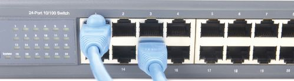
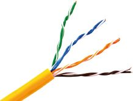
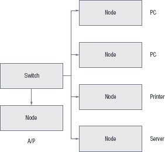

## UNIT 9.1 Essential parts to link nodes

A link node connects processing locations or nodes, like a computer or a printer. Networks are grouped into two types of networks: wired networks and wireless networks. To create a wired network, you need the following networking equipment:

- Switch
- Network cable
- Wireless base station

#### SWITCH

A switch or router are devices that allow multiple computers to connect to the same network. They can also be used to connect two networks to each other. A switch serves as a controller, enabling networked devices to talk to each other efficiently.

Did you know

Switch and router can be used interchangeably since modern routers come with a switch.

A router connects multiple networks together. They also connect computers on those networks to the internet. Routers enable all networked computers to share a single internet connection.

**Figure 9.1:** ***Switches allow multiple computers to connect to the same network***

#### NETWORK CABLES

Network cables are used to connect a computer to a local area network or one network to another network. If you are connecting directly to the internet, you may require a specific cable based on the type of internet you are using such as a DSL enabled phone cable or a fibre optic cable.

**Figure 9.2:** ***An ethernet cable is made up of four twisted pairs of wires***

#### WIRELESS BASE STATION

A wireless base station is a radio receiver/transmitter that serves as the hub of a local wireless network. It may also be used to link a wired network and the wireless network. It consists of a low-power transmitter and wireless router. It is basically a router that communicates with devices based on the Wi-Fi standard. The router creates a connection between two or more networks, usually a local network and the internet. This allows all computers on the local network to connect to the internet. Since most routers have multiple ethernet ports, routers can often be used as an ‘all-in-one’ solution, instead of using switches in small home and office networks.

 Activity 9.2 Setting up a network

**9.2.1**Choose the correct answer.

**a.**You want to connect your computer to a wired network. What equipment do you need?

**A.**Network cable and switch, router or wireless base station

**B.**Adapter, cable, WAP, network card

**C.**Wireless adapter, switch, ethernet cable, wireless access point

**D.**Router, switch, wireless access point, network card

**b.**This device connects a computer or network to the internet.

**A.**Switch

**B.**Router

**C.**LAN

**D.**Modem

**9.2.2**Give ONE word/term for each of the following descriptions. Write only the word/term next to the question number in your homework book.

**a.**If you are connecting directly to the internet, you may require a specific cable based on the type of internet you are using such as a _____ cable or _____ cable.

**b.**This piece of hardware allows a computer to connect to a network and is built into most computer’s and laptop’s motherboards.

**9.2.3**Choose the answer and write ‘true’ or ‘false’ next to the question number. Correct the statement if it is FALSE. Change the underlined word(s) to make the statement TRUE. (You may not simply use the word ‘NOT’ to change the statement.)

**a.**The speed at which you can send and receive data over the network will depend on the type of network and network card you use.

**b.**The image below shows a basic WAN setup.

