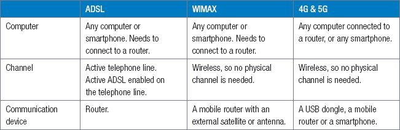
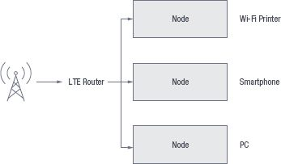
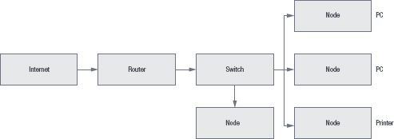

## UNIT 9.2 Connecting to the internet

By the end of this section, you should feel comfortable not only installing the hardware, but also choosing an appropriate internet connection for your household.

#### ROUTER OR MODEM

Routers and modems look similar but they each serve a different purpose.

ROUTER

A router is a small box that allows multiple computers to join the same network. Early routers only had Ethernet ports for wired connections, but now modern routers also provide wireless connectivity. They allow multiple computers and other devices, like smartphones and tablets, to join the same network. Most routers have a specific Ethernet port that is designed to connect to the Ethernet port of a cable or DSL modem.

MODEM

A modem is a device that provides access to the internet. It connects to your ISP, which typically provides either cable or ADSL internet service. Cable modems connects to a cable port on the wall like a telephone socket.

#### ACCESSING THE INTERNET

An ISP (Internet Service Provider) can provide you with either a wired or a wireless connection to the internet. In most situations, your ISP will provide you with the hardware you need to connect to the internet. However, if they do not you will need to ensure you have the following three pieces of hardware:

- computer
- internet connection channel
- internet communication device.

The table below summarises the needed for the different types of internet.

**Table 9.1: *Equipment needed for the different types of internet***

When you have connected the router to the internet, you need to create a connection between the router and your local area network and computers.One way to do this is by connecting computers directly to the router using Wi-Fi or ethernet cables, as shown in Figure 9.3. In this figure, a router connects to the internet using LTE, and multiple devices (including a smartphone and a PC) connect to the router using Wi-Fi

**Figure 9.3:** ***Connecting directly to the router***

A second way is to connect the router to the local network using an ethernet cable. In Figure 9.4, a router is connected to the internet as well as to a local area network’s switch. This allows all the computers on the local area network to connect to the internet.

**Figure 9.4:** ***Connecting a router to a LAN***

#### ALL-IN-ONE SOLUTION

All-in-one solution is to have a contract with an internet service provider (ISP). The ISP will charge you a monthly fee and, in return, allow you to use their network to connect to the internet. Most ISPs will also help you to set up your internet connection, from making sure you have the correct hardware to installing the telephone lines and setting up you the internet account.

 Activity 9.3 **Connecting to the internet**

**9.3.1**Choose the correct answer.

**a.**What is an ISP?

**A.**Internet silent partner

**B.**Internet service provider

**C.**Internet service partition

**D.**Internet shared partition

**b.**What equipment do you need to install a fibre network at home?

**A.**Any computer or smartphone, router, active fibre connection, ONT device

**B.**Any computer or smartphone, router, active telephone line, active DLS enabled on telephone line

**C.**Any computer or smartphone, mobile router with an external satellite or antenna,

**D.**Any computer or smartphone, mobile router, USB dongle

**c.**What equipment do you need to install a 4G and 5G network at home?

**A.**Any computer or smartphone, router, active fibre connection, ONT device

**B.**Any computer or smartphone, router, active telephone line, active DLS enabled on telephone line

**C.**Any computer or smartphone, mobile router with an external satellite or antenna,

**D.**Any computer or smartphone, mobile router, USB dongle

**9.3.2**When you have connected the router to the internet, you need to create a connection between the router and your local area network and computers. One way to do this is by connecting computers directly to the router using Wi-Fi or ethernet cables. Draw a diagram to show this type of connection and explain it in your own words.

**9.3.3**A second way is to connect the router to the local network using an ethernet cable. Draw a diagram to show this type of connection and explain it in your own words.

**9.3.4**Explain the all-in-one-solution; its advantages and disadvantages.
