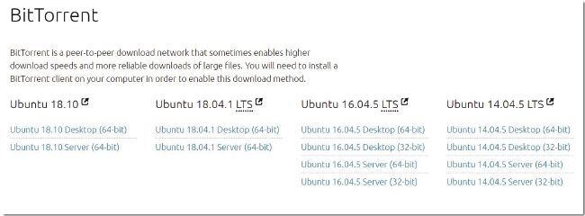
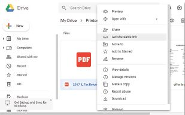

## UNIT 9.3 Sharing concepts

#### FILES AND FOLDERS

One of the biggest advantages of networks, , is the ability to share files and folders on one computer with other computers on the network. Once shared, people on the network can open and view the files or folders or they can copy the files to their own computers. Depending on the setup, these users might also be allowed to modify the files or delete the files.

#### USER RIGHTS

User rights allow you to set permissions for your shared files, giving different users access to use your files in different ways (such as reading, writing or modifying the files). In this way, it is possible to allow most users to simply read the files, while specific users can modify or update the files.

Example: on a school network, students are often able to write files to personal folders stored on a network but blocked from writing or changing files from other students’ folders. However, the network administrator can see or change files from any student’s folder.The advantages of using user rights are:

- It allows you to specify, in detail, which users have access to your files.
- It allows only specific users to change your files. This decreases the risk of viruses infecting your computer and users deleting your files.

The disadvantages of using user rights are:

- It is more time consuming and difficult to set up.
- It may require you to make changes to the user rights as new users are added.
- It may require you to make changes as user’s needs change.
- Some programs on a shared folder will not function if a user does not have full user rights.

#### BITTORRENT

BitTorrent (or torrents) is a peer-to-peer technology that can be used to share files. What makes torrent files unique is that they do not rely on a single peer sharing a file with lots of peers. Instead, anyone who downloads a torrent file automatically starts sharing it with other people. This means that if you have downloaded 10% of a shared file using torrents, you also share that 10% with new people who start to download the file.

Torrents facilitate the sharing of bandwidth allowing users to download files more quickly than they would from a single source.

BENEFITS

Torrents have many benefits, especially for people or organisations who need to share files with many people:

- The data used to upload the file is shared between all the users downloading the file.
- The bandwidth is also shared, allowing users to download the file more quickly.
- Since the file is not uploaded to a single website or hosted by a single user, people may continue to share it for years after it was first shared.
- For websites using torrents to share pirated material, the website itself is not sharing the illegal materials nor the files linking to the illegal materials. This makes it a lot harder to prosecute the website owners for copyright infringement.

DISADVANTAGES

Torrent files also carry several risks:

- Since the files are shared peer-to-peer, you can never be sure that the file you are downloading is what you are looking for. Many users have used torrent files to share viruses.
- Many ISPs throttle or shape torrent downloads, preventing you from downloading them at high speed.
- Torrents are often used to pirate videos and music. When you use torrents to download pirated material, you are also personally sharing pirated material with other people. Distributing pirated material is punished much more severely by the law than receiving pirated material.

Due to these advantages and disadvantages, the primary use of torrents is for downloading and sharing pirated television shows, movies, music and software. However, there are a few companies who share large applications (such as Linux installations) using torrents. The distributed nature of the sharing also makes it a good way to share massive files.

**Figure 9.5:** ***BitTorrent can be used to legally download applications like Ubuntu***

#### ONLINE SERVICES

Sharing files on a local network makes those files only available to the people able who are already connected to your network. If you want to share files with people on the internet (for example, share a group work project with friends), then you need to use an online service.Online Services are organizations that provides an information service over the Internet. Examples are search engines, cloud storage services and application service providers.Four popular online services are:

- Drop box: A popular cloud storage service from Dropbox, Inc. that is used to transfer abd synchronize files between desktop and mobile devices.
- MobileMe: A service that ensures your iPhone and computer are always in sync. It updates calendars, contacts and emails wirelessly. This online service Is being discontinued.
- GSuite: (formerly Google Apps) for Work is a suite of web applications created by Google for businesses. Includes Gmail, Docs, Drive, Calendar, Meet and more.
- Office 365 online: Lets you view and edit Office documents for free in your web browser (like Google Docs, but from Microsoft). All the same apps – Word, Excel, PowerPoint, and OneNote – are available.

Example 9.1 **Using online file storage applications**

**1.**Open [https://drive.google.com](https://drive.google.com) and sign in using your Gmail username and password.

**2.**If you are using Google Chrome, drag and drop files on the folder to upload them. If you are using a different browser, click on the *New* button, select *File Upload,* select the files you would like to upload, then click on the *Open* button.

**3.**To share these files, right click on a file or folder and select *Share.*

**4.**In the window that opens, enter the email address of the person you would like to share the file with.

**5.**Click on the pencil arrow next to the *People* textbox and select if the user can edit, view or comment on the shared files.

**6.**Click on the *Send* button. If you shared it with a Gmail address, then the user will receive an email and the file will appear in the *Shared* folder of Google Drive for them. If you shared it with a non-Gmail address, you will need to click on the *Send* button again.

 Activity 9.4 **Sharing files and folders**

**9.4.1**You want to convince your headmaster to install a network at the school.

**a.**Explain to him/her at least FIVE uses of such a network.

**b.**Your headmaster is quite positive about the possibilities but asks you to tell him/her what the risks of sharing files and folders over such a network could be. Describe at least FOUR of these risks to him.

One way to minimise these risks is by assigning the correct user rights to your shared files and folders.

**c.**Explain to your headmaster what user rights means.

**d.**What are the advantages as well as disadvantages of using user rights? List TWO of each.

**9.4.2**The network worked so well, that your headmaster decided to collaborate with a school in the UK so that the learners can learn new things by sharing certain assignments with the British learners.

**a.**How can this be done?

**b.**Give TWO examples of online file storage applications.

**9.4.3**What are the benefits of being able to share files on a network?

**9.4.4 a.**What is BitTorrent?

**b.**What makes it different from other file sharing applications?

**c.**How can you the use this application? Name at least TWO things you will be able to do.

**9.4.5 a.**Why do you think piracy websites do not host the copyrighted materials themselves?

**b.**How do BitTorrents solve these problems?

**9.4.6**Do you think there is a legal difference between hosting the pirated files, and hosting files that link to the pirated files (like torrents)?

**9.4.7**What do you think a reasonable punishment would be for downloading a pirated movie?

**9.4.8**Do you think downloading a torrent is the same as distributing pirated content?

**9.4.9**Why do you think so few legal websites make use of torrents?
