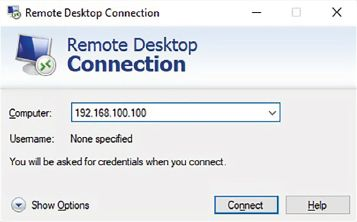
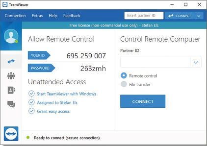
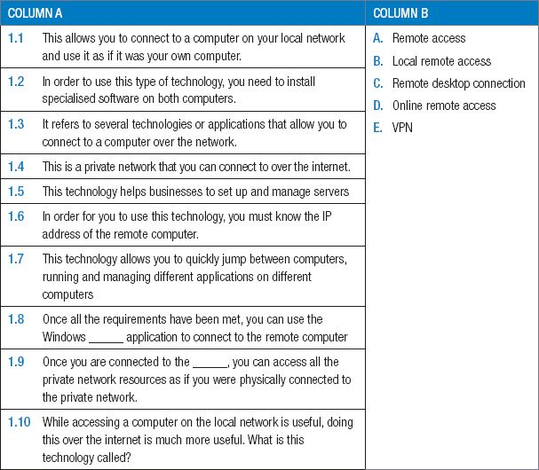
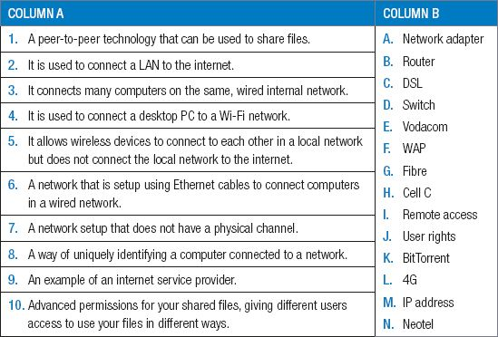

## UNIT 9.4 Remote access

**Remote access** refers to several technologies or applications that allow you to connect to a computer over the network. Once connected with remote access, you will see the remote computer’s display on your monitor, and you can use this computer as if it is your own computer. Generally remote access Is used for: opening applications, sending emails and fixing problems.

#### LOCAL NETWORK

Local network is remote access that allows you to connect to a computer on your local network and use it as if it was your own computer. However, you cannot simply use remote access to take over other people’s computers! For you to use it, the following requirements must be met:

- The remote computer must have remote access enabled.
- You must be on the same local network as the remote computer.
- You must know the IP address of the remote computer.
- You must know the username and password for the remote computer.

Once these requirements have been met, you can use the Windows Remote Desktop Connection application to connect to the remote computer.

**Figure 9.6:** ***Remote Desktop Connection***

#### ONLINE REMOTE ACCESS

While accessing a computer on the local network is useful, doing this over the internet is much more useful. This allows you to manage your home computer from school, or your work computer from home. It also allows you to connect to your friends’ or family’s computers from anywhere in the world, if both of you have internet connections.

To use online remote access, you need to install specialised software (such as TeamViewer) on both computers. Once installed, you can use the remote computer’s ID and password to access it online.

**Figure 9.7:** ***TeamViewer allows you to use remote access over the internet***

#### REMOTE ACCESS USING A VPN

A VPN (or virtual private network) is a private network that you can connect to over the internet. It is a service that encrypts your online traffic, enabling you to access the internet with complete privacy and security. Once you are connected to the VPN, you can access all the private network resources (such as shared files, printers and computers) as if you were physically connected to the private network.

Once connected to the virtual network, you can use remote access to connect to a computer on the VPN like you would connect to any local computer.

While accessing a computer on the local network is useful, doing this over the internet is much more useful.

 Activity 9.5 **Remote access**

**9.5.1**Match COLUMN A with the correct answer in COLUMN B. Write down only the question number and the matching letter in COLUMN B in your answer book. There can be more than one answer (column B) to a question (column A).

**9.5.2**What are the benefits of remote access in a home setup? Give examples to support your answer.

**9.5.3**What are the benefits of remote access in a work environment? Give examples to support your answer.

**9.5.4**An example of remote access is being able to access your home security system while away from home – like being able to open your gate to your home when you’re away. List the advantages and disadvantages of this.

CONSOLIDATION ACTIVITY Chapter 9: Networks

**1.**Choose the correct answer.

**a.**Which of these devices does NOT usually have a built-in network adapter?

**A.**Desktop PC

**B.**Laptop

**C.**Smartphone

**D.**Tablet

**b.**Which of the following has the fastest mobile internet speeds?

**A.**4G

**B.**3G

**C.**Ethernet

**D.**Wi-Fi

**c.**Which of the following makes use of a SIM card?

**A.**Modem

**B.**Switch

**C.**DSL cable

**D.**Ethernet cable

**d.**Which of the following CANNOT be used in a wired network?

**A.**WAP

**B.**Switch

**C.**Router

**D.**Ethernet cable

**2.**Indicate if the following statements are ‘True’ or ‘False’. Choose the answer and write ‘true’ or ‘false’ next to the question number Correct the statement if it is FALSE. Change the underlined word(s) to make the statement TRUE. (You may not simply use the word ‘NOT’ to change the statement.)

**a.**A fibre optic cable makes use of telephone lines.

**b.**A Wireless Access Point can be used to create and facilitate an intranet.

**c.**4G has the slowest internet speeds.

**d.**A notebook uses a switch to connect to the DSL cable that connects it to the router that connects it to the internet.

**3.**Choose a term/concept from COLUMN B that matches a description in COLUMN A. Write only the letter next to the question number (e.g. 1–A).

**4.**Give ONE word/term for each of the following descriptions. Write only the word/term next to the question number in your homework book.

**a.**Networks can generally be categorised based on their size.

**i.**This computer network covers a small area like a home, office or building, has a limited number of computers connected to it using either ethernet or Wi-Fi.

**ii.**This network covers a large area and is most often used to refer to the internet. This type of network is not private but is usually organised by communities or businesses.

**b.**Another way to categorise networks is based on the way computers on the network are connected to each other.

**i.**These networks have no central computer, server or person that manages the network. Instead, each computer on the network connects directly to the network and the other computers on the network. Computers on these networks are visible to each other and can share files and resources with each other.

**ii.**These networks are managed by one or more servers to make sure that everyone can access the network, that people only have access to the correct resources and that problems on the network are resolved. In many cases, computers connected via these networks cannot see each other.

**5.**List FOUR advantages of a local network.

**6.**List TWO advantages of using BitTorrents.

**7.**Thuli and a group of her university colleagues have decided to start up a small graphics design company. They have decided to call the company United Designz and have a rented a whole floor of a business building.

**a.**Being one of the lead graphic designers in the company, mention what type of computer Thuli will need to do her work.

**b.**What type of network should her company use? Give a reason for your answer.

**c.**Do you think United Designz should make use of a wired or wireless network? Give TWO reasons for your answer.

**d.**What type of downloading speed would be ideal for a company like United Designz? Also give a reason for your answer.

**e.**Based on your previous answers and what is required to create an internet-enabled network, identify THREE specific networking equipment United Designz should use?

**f.**To make file sharing easier amongst the company’s employees. Thuli has decided to set up a local network for the company. List THREE user rights she should set up.

**g.**Some of the employees of United Designz travel a lot, so to access the company’s files and documents. What type of remote access should these employees use? Give a reason for your answer.
