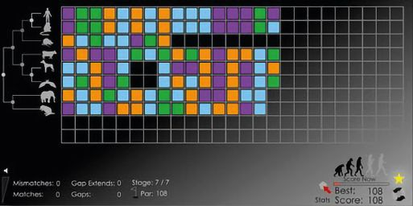
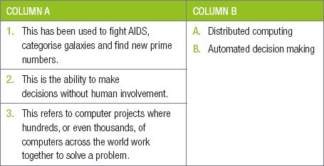

## UNIT 11.1 Computers provide solutions to issues of national and international importance

#### INTRODUCTION

In Grade 11, you saw how computers can be used to solve real world problems. This included specific case studies on the weather, elections and censuses, but also included a more general discussion of new technologies, including Als that can diagnose cancer and create legal briefs and self-driving cars.In this section, you will look at two new techniques that programmers use to solve problems:

- Distributed computing
- Decision making

#### DISTRIBUTED COMPUTING POWER

Distributed computing refers to computer projects where hundreds, or even thousands, of computers across the world work together to solve a problem, for example, the free, online game called *Phylo.*

In this game, players could use coloured blocks to build DNA and were asked to compare DNA sequences between different species. The closer the match, the higher score players would receive.

**Figure 11.1: *Phylo asked gamers to compare DNA sequences using coloured blocks***

While the game itself was interesting, it was a distributed computing project. The goal of Phylo was not just to entertain people, but also to help align DNA sequences correctly and to recognise patterns that computers struggle to recognise. By playing the game, the gamers helped researchers to better understand several different diseases.Similar distributed computing power has been used to:

- Find a solution for the Ebola virus
- Find a solution for certain strains of childhood cancer
- Find new prime numbers
- Categorise galaxies
- Search for alien life
- Fight AIDS

Did you know

GIMPS, or the Great internet Mersenne Prime Search, is a distributed computing project to find large prime numbers. Anyone who runs the software and finds a new, undiscovered prime number receives a cash prize of roughly R50 000. Anyone finding a prime with more than 100 million digits will receive a prize of almost R2 400 000! The largest prime number discovered by 2018 has 23,25 million digits.

By allowing people who care about a topic to pool their resources, the creators of these projects gain access to an incredible amount of resources that they might not have had on their own.

#### DECISION MAKING

Computers have changed, and is continuing to change, human decision making. For thousands of years, people have seen human intelligence and the ability of humans to make decisions as the primary difference between humans from animals. Over the last 30 years, and especially the last 10 years, humans are giving up more and more of their decision-making responsibility to computers. This ranges from decisions as simple as when to do exercise or which road to take to work, to potentially life changing decisions such as which romantic partners would suit you and what job occupations would suit you.

As computers become more intelligent and learn more about us, they will undoubtedly play an even bigger role in human decision making.

 Activity 11.2 **Decision-making**

**11.1.1**Match the COLUMN with the correct answer in COLUMN B. Write down only the question number and the matching letter in COLUMN B in your answer book.

**11.1.2**This activity can either be a discussion in class or learners can answer the questions individually in their homework books.

**a.**Do your own research and write a paragraph either agreeing or disagreeing with the statements below:

**i.**Humans will always be able to make better complex decisions than computers.

**ii.**Soon, computers will be able to do most jobs, including knowledge jobs such as doctors, lawyers and accountants, better than humans.

**iii.**Soon, your computer and smartphone will be able to analyse all the information It has recorded about you and your friends and provide you with concrete social suggestions such as “You need to spend more time with Mark” or “You and Relebohile would make an excellent couple.”

**iv.**The more decisions computers can make; the easier life will be for humans.

**v.**When you allow computers to make too many decisions, you place too much power in the hands of computer programmers.
