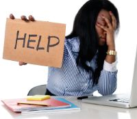
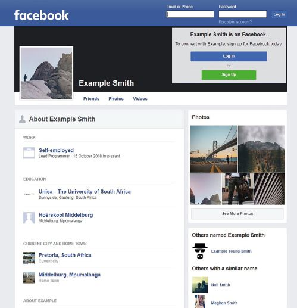
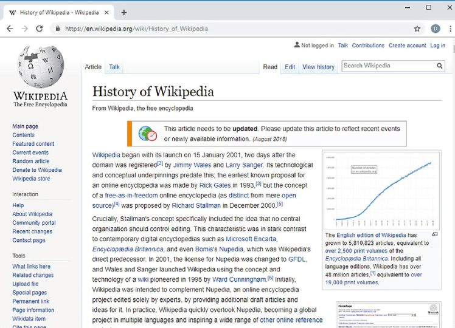

## UNIT 11.2 The evolution of social networking and the effect on society

#### INTRODUCTION

Using computers, the internet and social websites have made significant improvements to the world. They have made it easier for people to be more social, made it easier to connect with people who are far away, made communication more affordable, made it easier to find a community of similar people, and allowed people to begin building databases of the world’s knowledge. At the same time, it is important to stay aware of the potential risks and problems linked to these improvements.

#### INFORMATION OVERLOAD

While social networks do allow people to stay connected to their friends, they can also lead to social media information overload. This occurs when there is too much information available, with new messages, photos and notifications demanding your attention every minute of the day. Rather than spend their time productively, people can spend every free minute they have reading social media posts making them less productive, less able to obtain new information, more stressed and can even cause depression!

**Figure 11.2: *Social media overload can cause depression***

If you find yourself spending too much time on social media, you can try the following:

- Limit the time you spend on social networks to five minutes, three times a day
- Do not save your username and password, so that you are forced to enter these each time
- Unfollow or mute people who fill your social media page with useless information
- Disable social media notifications on your phone
- Uninstall or stop using any services that do not improve your life

**Animation**

Animation showing five techniques to prevent social media overload:

**1.**Limit time you spend to 5 minutes

**2.**Do not save username and password

**3.**Unfollow or mute people

**4.**Disable notifications on phone

**5.**Stop using services that do not improve life.

 Activity 11.3 Social media overload

This activity can either be a discussion in class or learners can answer the questions individually in their homework books.

**11.3.1**How you feel about social media overload.

**11.3.2**What is social media overload?

**11.3.3**Do you use social networks websites or applications on most days?

**11.3.4**Do you enjoy using social networks or do you see it as a chore?

**11.3.5**Do you occasionally feel stressed after using social networks?

**11.3.6**Do you think, in general, that social networks make people happier?

**11.3.7**How easy would it be for you to stop using all social networks?

**11.3.8**What can you do if you find yourself spending too much time on social media? List at least THREE things to do.

#### AVAILABILITY OF PERSONAL INFORMATION

PERSONAL INFORMATION

Social networks like Facebook and Twitter are a great way to keep in touch with friends and acquaintances. They can also be used to meet new people with common interests and talk about the things you have in common. At the same time, unless you specifically change it, most social networks share a lot of the information that you place on their website publicly. This means that anyone on the internet can see this information.

**Figure 11.3: *Facebook shares a lot of information publicly, unless you specify differently***

This can result in uncomfortable family moments when your parents see exactly what you did during the holiday with your friends! It can also have more permanent, long-term consequences, such as costing you a job. In today’s competitive job market, there is a growing trend for employers to look at the social media profiles of applicants before making any hiring decisions

Publicly available online information has also been used to commit crimes. Burglars have used tweets or public photos to see when families are away from home or on vacation. This allowed them to burgle houses at a time they knew the houses would be empty. Stalkers have also used publicly posted information (such as tweets or photos on Instagram) to stalk their victims.

 **Case Study** **Stalking and social media**

**SEARCH ENGINES AND GROUP COMMUNICATIONS**

**Consequences of search engines**

Every search engine consists of some algorithm that determines how the engine searches the database and shows the results of the search. Web sites hope to make a profit on their business enterprises at some point. If you understand the significant role search engines play in the web surfing behavior of internet users, you can see the value a corporation might place in having its web site be returned as the first and ‘most appropriate’ result of a search engine’s search. ‘Ask google’: results in people having poor recall of knowledge if they knew where answers to questions were easily found.

**Consequences of group communications**

Many people go through their lives feeling like they do not fit in. They might have different interests or different beliefs from the people around them, or they may feel awkward in social contexts.

One of the big advantages of social websites is that it allows users to find like-minded people who share their interests and beliefs. For many people, the internet is a place where they can show a part of themselves that they feel the need to hide in real life.

The downside of finding like-minded individuals is that it allows people to create a context in which their ideas are never challenged. Today, you can go online and speak with thousands of people who share your beliefs, reinforcing your (incorrect) beliefs.

As a result, rather than using the internet to expand their horizons and encounter new people with new ideas, people often surround themselves with too many similar people, strengthening their existing (and often bad) ideas. This is particularly problematic with racist social network groups where users can surround themselves with people sharing and speaking about their racism, rather than surrounding themselves with people who will challenge these views.

 **Case Study** Alt-right

**Social, political, environmental**

*Social*

Recent research found that almost a quarter of the world’s population is now on Facebook. Social networks grow more powerful with the increase in interactions among people on social platforms. People can find others like them, with their beliefs through social media. People can also create memes (an image, video, piece of text, etc., typically humorous in nature, that is copied and spread rapidly by Internet users), publications, Virtual online worlds, and so on.

Some people believe that social media encourages people to use mobile devices to express their concerns on social issues without engaging actively with real life campaigns. Their support is limited to pressing the ‘Like’ button or sharing content.

*Political*

Social networks play an increasingly important role in electoral politics. Social networks are helping to fundamentally rewire human society. Social media lets people freely communicate with one another and they are helping to create influential social organisations among once-marginalised groups.

*Environmental*

Social media increasingly supports environmental campaigns and connects people on major environmental issues such as climate change. It also provides people with the ability to track the quality of the air and water around them and then share this data with others. Social media has propelled the rise of the independent activist. For example, when Cape Town went through water restrictions, many people shared their personal views and tips on saving water on social media. This brings about an awareness that otherwise might have gone unnoticed.

 Activity 11.4 **Social websites**

This activity can either be a discussion in class or learners can answer the questions individually in their homework books.

**11.4.1**How do you feel about social, political and environmental communities?

**11.4.2**Do you belong to any of these communities?

**11.4.3**Do the people in this community share most of your opinions?

**11.4.4**How likely are you to encounter people with different opinions?

**11.4.5**Do you think the internet is making it easier or harder to become an activist?

GLOBAL COMMUNITY – CULTURAL EFFECTS

Globalisation allows people from across the world to form part of a global community where everyone can share and enjoy other people’s cultures. For example, most people today watch international movies and listen to international music. There are also many people who are interested in and follow international news.

The risk with the global community is that smaller cultures may disappear. In South Africa, especially among young people who rely on the internet for entertainment, many people rarely watch South African television shows or listen to South African music. Many people are also more interested in international than local affairs, and more interested in international celebrities than local celebrities. This constant focus on international entertainment, news and people can increase the cultural attraction to countries with a large cultural impact (such as the United States) while decreasing the power of smaller cultures.

For many people, culture is an important part of a person’s identity, so losing your own culture, or seeing your culture as second to an international culture attacks that identity.

Groups consisting of people with different cultures can improve the groups’ performance.

If all small cultures are swallowed by larger, more dominant cultures, some unique ideas and perspectives on the world could disappear.

 **Activity 11.5** **Group communication**

This activity can either be a discussion in class or learners can answer the questions individually in their homework books.

**11.5.1**How you feel about a global community? Give reasons for your answers where applicable.

**11.5.2**How does a global community differ from an online community?

**11.5.3**Are you more likely to follow local or international entertainment?

**11.5.4**Do you see yourself as a South African citizen or as a citizen of the world?

**11.5.5**Do you think it is important for countries to protect their local cultures?

**11.5.6**How do you think smaller countries can protect their local cultures?

**11.5.7**South Africa is a country with a lot of different cultures. Do you think this makes it easier or harder to maintain our culture?

SOCIAL WEBSITES AND SOCIAL ENGINEERING

A few examples ways In whichh social engineering is practiced include:

- Baiting: This depends on a victim taking the bait, similar to a fish reacting to a worm on a hook. The person dangling the bait wants to entice the target into taking action e.g. unknowingly downloading malware on a server.
- Phishing: This grabs information from an unwitting victim to seek information that might help with a more significant crime.
- Email hacking and contact spamming
- Pretexting: Is a trick to get someone’s attention so the fraudster can trick the would-be victim into providing something of value.
- Quid pro quo: This scam involves an exchange, I give you this, and you give me that. Fraudsters make the victim believe it’s a fair exchange, but that’s far from the case, as the cheat always comes out on top.

**New words**

**Social website** - an online platform that allows users to create a public profile and interact with other users on the website

**Social engineering** - the act of tricking someone into giving information or taking action they usually wouldn’t take

 Activity 11.6 **Social websites and social engineering**

This activity can either be a discussion in class or learners can answer the questions individually in their homework books.

**11.6.1**How you feel about social engineering? Give reasons for your answers where applicable.

**11.6.2**What type of information is the fraudster looking for and why?

**11.6.3**How can you not fall for social engineering?

WIKIS

Wikis are encyclopaedias that can be edited by anyone. They can be general encyclopaedias (like Wikipedia) which allows users to create entries for any topic, or they can be very specific, such as the **esports** Wiki called Liquipedia, which only allows users to add information on the esports-related topics.

**Figure 11.4: *Wikipedia is an example of a general wiki***

Because anyone can contribute information to the wiki, these encyclopaedias can grow incredibly quickly. For example, Wikipedia contributors have written and edited more than 27 billion words across 40 million articles! If the average professional author can write 100 000 words in a year, it would have taken a team of 1 000 professional authors 270 years and hundreds of billions of Rand to create an encyclopaedia as large as Wikipedia. Instead, the information on Wikipedia was written and edited in less than 18 years for free!

Since anyone can update a wiki, they are also easier to maintain and keep up to date. Whenever a large event occurs, hundreds of contributors are ready to update the wiki with the newest information.This does not, however, suggest that wikis are perfect. Instead wikis are faced with several challenges, including:

- Quality of information: Because anyone can edit the information, many people doubt the quality of information stored on wikis. However, several studies have shown the quality of information on Wikipedia is comparable to that of top encyclopaedias written by experts.
- Bias of editors: Since anyone can edit an article, rather than those with a neutral view of the topic, are most likely to edit the pages. This means that there are often edit wars about controversial topics, with one group of editors writing the article so that the information is positive, and another group so that the information is negative.

While these criticisms have mostly looked at Wikipedia, this is because Wikipedia is by far the largest and best moderated wiki. These issues become even more significant on smaller wikis, where a small number of contributors can have a large impact on the quality of the wiki.

 Activity 11.7 Wikis

This activity can either be a discussion in class or learners can answer the questions individually in their homework books.

**11.7.1**How do you feel about wikis?

**11.7.2**What is a Wiki?

**11.7.3**Do you ever use wikis? Have you used wikis outside of Wikipedia?

**11.7.4**Do you think people can trust the information they read on Wikipedia?

**11.7.5**Do you think Wikipedia should be used as a research tool for school projects?

**11.7.6**Do you think it is a problem that most Wikipedia articles are written by men?

**11.7.7**Do you think bias on Wikipedia is a significant problem? How can you know if an article is biased?

Did you know

- **Non-diverse editors:** The bias of the information may not always be intentional. A 2013 study found that 90% of Wikipedia’s editors were men. As a result, the information on Wikipedia may be biased towards men.
- **Vandalism:** Vandalism occurs when the information on a page is purposely changed to be incorrect or misleading. For example, after South African swimmer Chad Le Clos received a silver medal at the 2016 Olympics, his Wikipedia page was edited to state that he “died at the hands of Michael Phelps, being literally blown out of the water by the greatest American since Abraham Lincoln.”
- **Privacy:** Privacy concerns have been raised when relatively unknown people receive Wikipedia pages containing personal information about them against their wishes.
